# دليل المستخدم الشامل — نظام الصادر والوارد والداخلي

> نسخة قابلة للطباعة والإرسال: [user-guide.html](user-guide.html)

دليل للمستخدم النهائي (مشرف القسم / مشرف الأرشيف / مشاهد). إعدادات الإدارة خارج نطاق هذا الدليل.

---

## 1) تسجيل الدخول

1. افتح رابط النظام من رسالة الدعوة.
2. أدخل **البريد الإلكتروني** (اسم الدخول).
3. أدخل **كلمة المرور**.
4. اضغط **دخول**.
5. من **ملفي الشخصي** غيّر كلمة المرور في أول دخول.

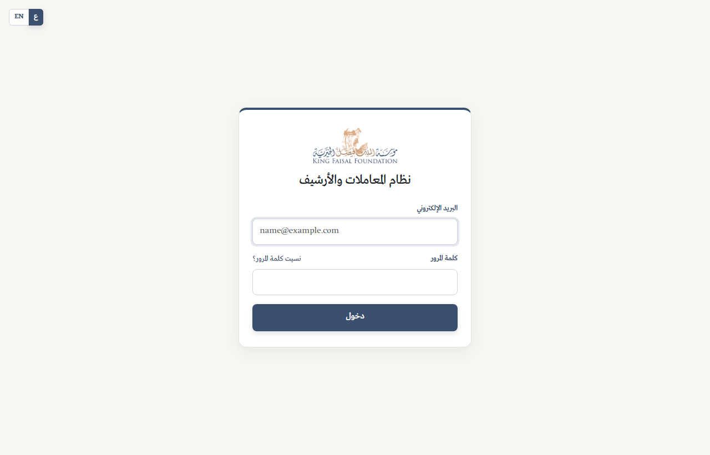

**نسيت كلمة المرور؟** استخدم الرابط أسفل حقل كلمة المرور.

---

## 2) الشريط العلوي

- **ع / EN** — تبديل لغة الواجهة فوراً.
- **جرس الإشعارات** — وارد جديد، إحالة، اقتراب موعد الرد. النقر يعلّم مقروءاً ويفتح الرابط.
- **عرض الكل** / **تعيين الكل مقروءاً** من قائمة الإشعارات.
- الملف الشخصي و**خروج**.

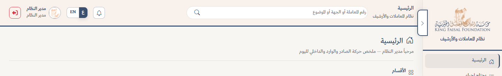

---

## 3) الصفحة الرئيسية

في الأعلى بطاقات **الأقسام**: الصادر، الوارد، والداخلي (حسب صلاحيتك)، مع اختصارات الإنشاء والقائمة وإحصاءات اليوم وقيد الإجراء.

ثم **متابعة عامة**: المنجزة، يحتاج إجراء اليوم، والمتأخرة.

وأسفلها **روابط أخرى** مثل التعاميم والإحالات والتقارير.

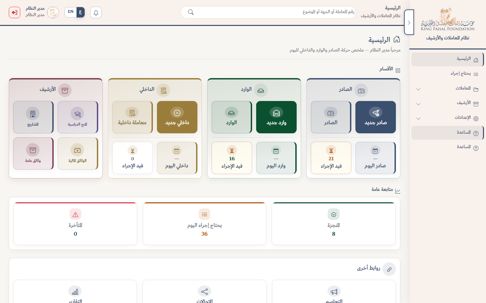

تظهر البيانات حسب القسم والصلاحيات.

---

## 4) القائمة الجانبية

تظهر القائمة على يمين الشاشة (أو يسارها بالإنجليزية). مثال مع قائمة الصادر:

| القائمة | الاستخدام |
|---------|-----------|
| الرئيسية | الملخص والمتابعات |
| الوارد | تسجيل ومتابعة الوارد |
| الصادر | إنشاء ومتابعة الصادر |
| المعاملات الداخلية | مراسلات بين الأقسام مع إحالة تلقائية |
| يحتاج إجراء | ما ينتظر خطوة |
| الإحالات | بين الأقسام |
| التعاميم | التعاميم الداخلية |
| جهات المراسلة | بيانات الجهات |
| مجموعات الجهات | مستلمون متكررون |
| قوالب الخطاب | نصوص جاهزة |
| التقارير | إحصاءات وتصدير Excel |
| ملفي الشخصي | الاسم والصورة وكلمة المرور |

قد يُخفى بند **المعاملات الداخلية** من الشريط الجانبي إذا أخفاه المدير من **إدارة القائمة الجانبية** (إخفاء عام للجميع)، أو إذا أُلغي ظهوره لبعض الأدوار من تعديل العنصر.

---

## 5) البحث والفلترة في القوائم

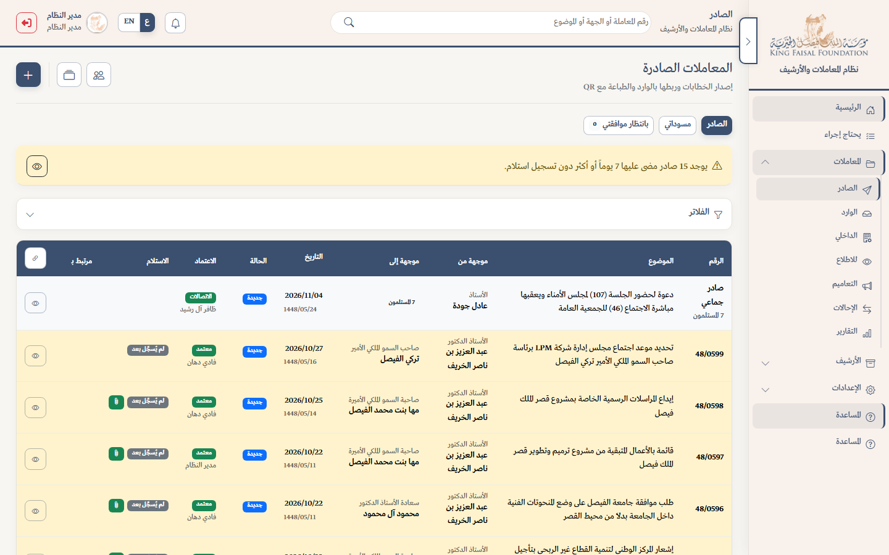

من **الوارد** أو **الصادر** أو **المعاملات الداخلية**:

| الفلتر | المعنى |
|--------|--------|
| بحث | رقم / موضوع / جهة أو قسم |
| الحالة | مثل جديدة أو قيد الإجراء أو مغلقة |
| يحتاج متابعة | ما ينتظر إجراءً |
| القسم | حسب الصلاحية |
| الفترة | من/إلى (ميلادي أو هجري) |
| الاستلام (صادر) | بدون استلام / تم التسجيل / متأخر |

تصدير Excel للقوائم من **التقارير** وليس من قوائم المعاملات.

---

## 6) الصادر (مفرد)

1. **الصادر** ثم صادر جديد.
2. الموضوع + الجهة المستلمة + القسم/التوقيع + التاريخ + أولوية/سرية.
3. أرفق ملفاً إن لزم ثم احفظ.
4. من العرض: إرسال، استلام، قائمة **طباعة** (نموذج التسليم / ملصق الظرف / ملصق حراري)، تعليقات، ربط بوارد؛ وإقفال / **إلغاء / سحب** من مجموعة الإجراءات الحساسة. على الجوال: الأزرار الثانوية خلف **المزيد**. (الإحالة بين الأقسام للوارد والداخلي فقط.)

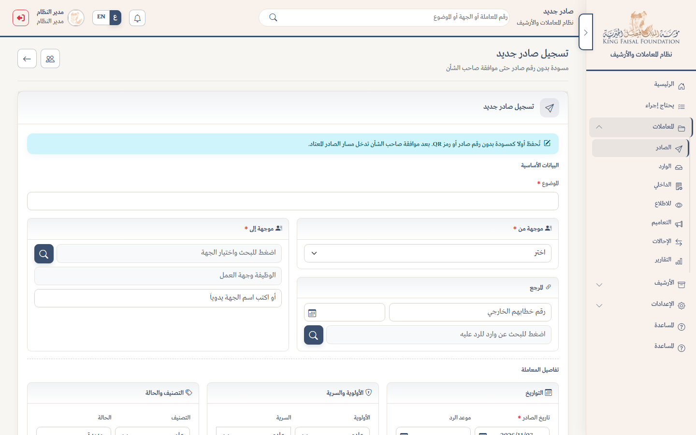

يمكن إدخال «مرجع وارد» كنص خارجي دون ربط تلقائي بسجل وارد.

### المراجعة والاعتماد قبل الإصدار

إذا فعّل مدير النظام موافقة الصادر، لا يُطبع الصادر ولا يُرسل قبل اعتماده. وإذا فعّل مرحلة المراجعة، يمرّ الصادر بالمراجعة أولاً.

1. من صفحة العرض: **إرسال للمراجعة** (أو **طلب موافقة الإصدار** إن كانت المراجعة غير مفعّلة).
2. يصل إلى **المراجع الأول** ويظهر عنده في «يحتاج إجراء» ثم **يحتاج مراجعة**. إذا انتهت مهلته دون قرار يُحوَّل إلى **المراجع الثاني**.
3. المراجع: **مطابقة — إحالة للاعتماد** فينتقل إلى المعتمد الأول، أو **إعادة بملاحظات** فيرجع إليك للتصحيح ثم **إعادة الإرسال للمراجعة**.
4. بعدها يعتمد المعتمدون بالتسلسل (الأول، ثم الثاني بعد مهلته، ثم الثالث بسبب إلزامي)، ثم يصبح الصادر جاهزاً للإصدار.

**ما يُراجَع:** البيانات، والجهة، والمرفقات، والصيغة.

**قرارات المراجع:** مطابقة ثم بانتظار الاعتماد، أو إعادة بملاحظات ثم المسودة.

**الضوابط:**

- المراجعة للشكل والإجراء فقط، والمضمون والقرار للمعتمد.
- الإعادة تكون بملاحظات مكتوبة إلزامية.
- من أعدّ المعاملة لا يراجعها، ومن راجعها لا يعتمدها.
- أي تعديل بعد المراجعة يعيد المعاملة للمراجعة.
- تعمل المراجعة ضمن مسار موافقة الإصدار، فيلزم تفعيله وتحديد المعتمد الأول.
- إن لم يوجد مراجع مؤهَّل (غير المُعِدّ) تنتقل المعاملة مباشرة إلى المعتمد الأول.

يحدد مدير النظام المراجع الأول والثاني والمهلة من الإعدادات ثم الصادر. إن تُركا فارغين يراجع أي مستخدم من «الاتصالات الإدارية».

---

## 7) صادر جماعي

نفس الخطاب لعدة مستلمين — لكل مستلم **رقم صادر وQR مستقل**.

1. **الصادر** ثم **صادر جماعي**.
2. الموضوع + **موجهة من** + اختيار **المستلمين** (مجموعة أو يدوي).
3. التاريخ والأولوية والسرية والتصنيف.
4. مرفقات اختيارية، وخيارات مثل **تأكيد الحضور** أو **الخطاب الرسمي كمرفق** للبريد.
5. اكتب **نص الخطاب** أو أدرج قالباً، ويمكن تفعيل **رابط في الخطاب**.
6. احفظ/أصدر حسب مسار الموافقة في جهتك (رقم وQR لكل مستلم).
7. من النتائج: إرسال المحددين (بريد / واتساب)؛ قائمة **طباعة** (نموذج التسليم / الخطابات / الملصقات / حراري / كشف المرسل إليهم)؛ تصدير من الشريط أو **المزيد** على الجوال.

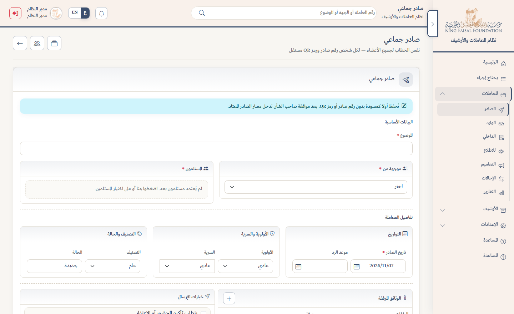

### نص الخطاب في الجماعي

تبويب عربي/إنجليزي، إدراج قالب، شريط الإدراج والتنسيق، مربع النص، ثم خيار **رابط في الخطاب**.

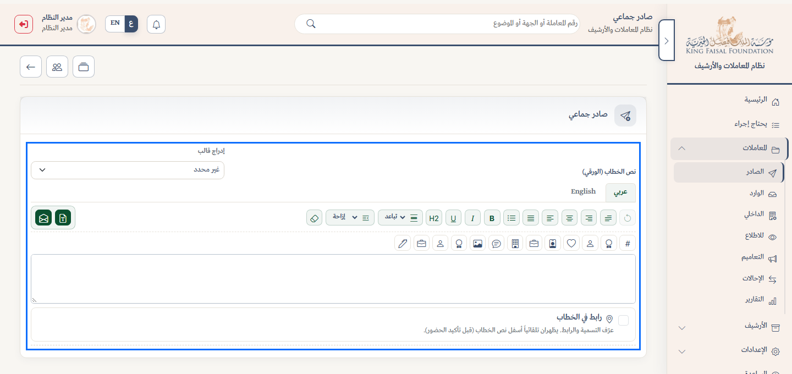

---

## 8) الوارد

### تسجيل وارد جديد

1. **الوارد** ثم وارد جديد.
2. الموضوع وتاريخ الاستلام والجهة المرسلة.
3. **رقم خطاب الجهة** (رقمهم الخارجي).
4. اختياري: **ربط بصادر**.
5. القسم وموعد الرد والأولوية/السرية ثم احفظ.
6. المرفق اختياري عند الحفظ (مثلاً ظرف مغلق) — ارفع المسح لاحقاً من صفحة العرض.

| الحقل | المعنى |
|------|--------|
| الجهة المرسلة | من أرسل الخطاب إليكم |
| رقم خطاب الجهة | رقمهم الخارجي |
| ربط بصادر | علاقة داخل النظام |
| موعد الرد | آخر موعد متوقع للرد |
| رقم الوارد | يُنشأ تلقائياً |
| المرفق | اختياري الآن؛ يُرفع لاحقاً إن لزم |

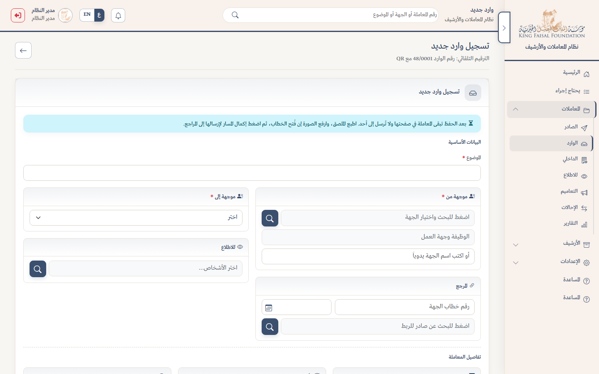

### متابعة بعد الحفظ

رفع مرفقات، إحالة، تعليقات، ورقة عرض، **إنشاء رد**، قائمة **طباعة** (نموذج الاستلام / ملصق الظرف / ملصق حراري) حتى الإغلاق.

---

## 9) المعاملات الداخلية

المعاملات الداخلية لمراسلات **بين الأقسام** داخل الجهة (ليست جهة خارجية). عند الحفظ تُنشأ إحالة تلقائية للقسم المستلم.

### إنشاء معاملة داخلية

1. **المعاملات الداخلية** ثم **معاملة داخلية جديدة** (أو من الرئيسية: داخلي جديد).
2. أدخل **الموضوع**.
3. حدّد مسار المعاملة: **من قسم إلى قسم** (لا يجوز أن يكونا نفس القسم).
4. التاريخ، موعد الرد إن لزم، الأولوية والسرية، وملاحظات اختيارية.
5. أرفق ملفاً اختياريًا ثم **حفظ وإحالة**.
6. يُمنح رقماً تلقائياً ببادئة الداخلي (غالباً مثل: د/2026/…) وتُحال للقسم المستلم.

### القائمة والعرض

- القائمة تعرض: الرقم، الموضوع، **من / إلى**، التاريخ، موعد الرد، القسم المستلم، الحالة.
- من صفحة العرض: قائمة **طباعة** (نموذج التسليم / ملصق الظرف / ملصق حراري)، ورقة عرض، مرفقات، تعليقات، إحالات، تغيير الحالة، إقفال.
- على الجوال: الأزرار الثانوية خلف **المزيد**؛ والإجراءات الحساسة (إقفال / تعديل) في مجموعة منفصلة.
- أسماء مديري الأقسام (الموجّه من / إلى) تُحفظ مع المعاملة عند الإنشاء؛ تعديل بطاقة القسم لاحقاً لا يغيّر المعاملات القديمة.
- **لا يوجد** تعديل للقيد بعد الإنشاء من الواجهة، و**لا يوجد** إلغاء/سحب (خاص بالصادر فقط).

| مقارنة سريعة | داخلي | وارد | صادر |
|---|---|---|---|
| الطرف | قسم إلى قسم | جهة خارجية | جهة خارجية |
| عند الحفظ | إحالة تلقائية للمستلم | تسجيل وارد | إعداد/إرسال |
| ورقة العرض | نعم | نعم | لا |
| ملصق الظرف | بيانات **القسم المستلم** | من الجهة | إلى الجهة |
| ملصق حراري | رقم + تواريخ + QR | نفس المحتوى | نفس المحتوى |
| إلغاء/سحب | لا | لا | نعم |

---

## 10) الأولوية والسرية

عند إنشاء وارد أو صادر أو داخلي تظهر بطاقة **الأولوية والسرية** (قيم افتراضية: عادي). يمكن للإدارة تعديل المسميات من **مسميات القوائم**. لا تغلقان المعاملة وحدهما.

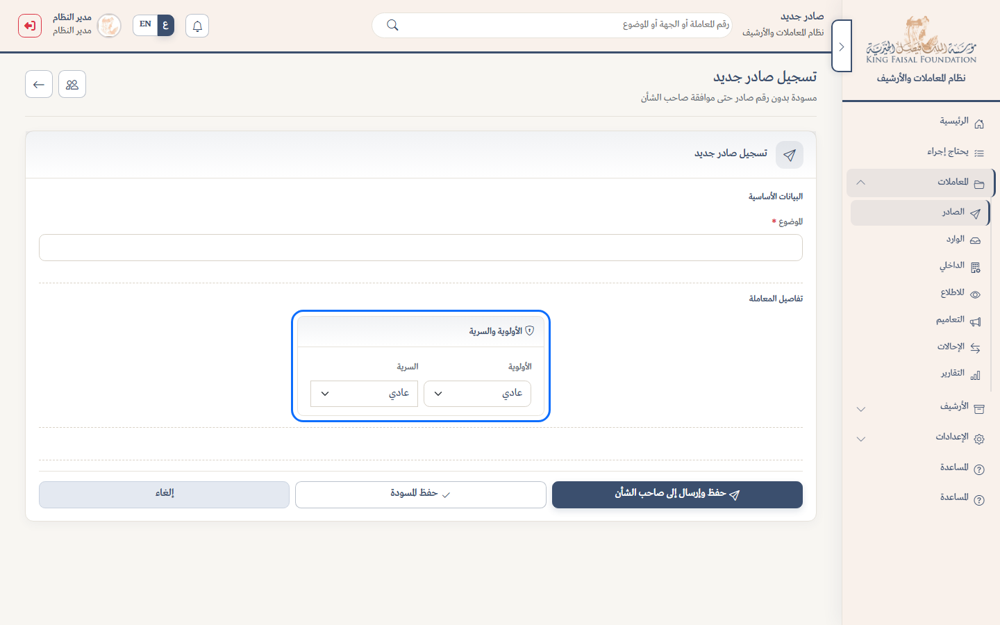

### ماذا يعني «سري» عملياً؟

- **الرؤية:** زميل القسم غير المخوّل لا يرى المعاملة السرية في القوائم. يراها المنشئ، ومسار الإسناد، ومن لديه صلاحية الاطلاع على السري حسب النوع، ومدير النظام.
- **المرفقات:** قد يفتح أحدهم المعاملة ويكمل عمله دون تحميل الملفات، حسب إعداد الأدوار في **إعدادات السرية**. زر القفل بجانب حقل السرية يفرض **سماحاً أو حظراً** لهذه المعاملة فقط.
- **البريد وواتساب والإشعارات:** الافتراضي نص محايد (رقم/نوع) بلا موضوع كامل ولا مرفقات سرية؛ ومن لا يرى المعاملة لا يُشعَر بها.

تفاصيل مدير النظام: [25-confidential-correspondence.md](25-confidential-correspondence.md).

---

## 11) المرفقات

من صفحة **عرض** الوارد أو الصادر أو الداخلي: بطاقة **الوثائق المرفقة** — ارفع **PDF أو صورة**، واحذف الخاطئ بعد التأكيد.

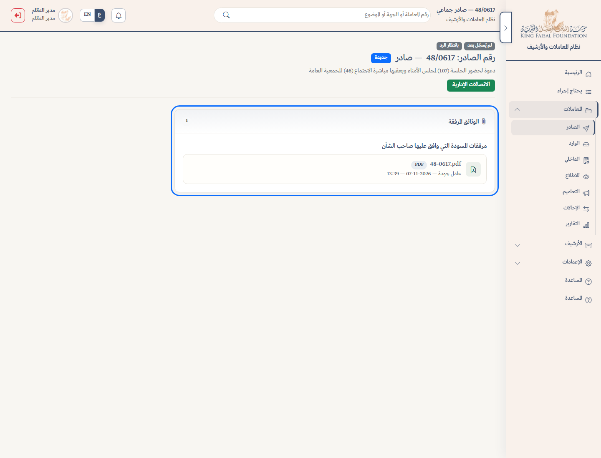

---

## 12) إرسال الصادر

من عرض الصادر الإلكتروني: بطاقة **إرسال الخطاب** (بريد وواتساب).

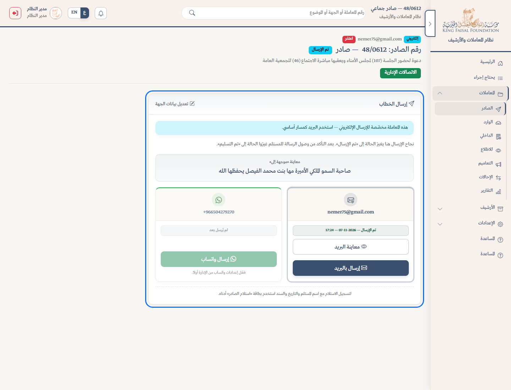

1. أكمل البيانات والمرفق.
2. من الصادر: بريد أو واتساب ثم أكّد.
3. في الجماعي: إرسال المحددين من صفحة النتائج.

تأكد من جوال/بريد الجهة قبل الإرسال. (الإرسال الخارجي خاص بالصادر وليس بالمعاملة الداخلية.)

---

## 13) تسجيل استلام الصادر

من عرض الصادر: بطاقة **استلام الصادر** (للتسليم اليدوي/الورقي).

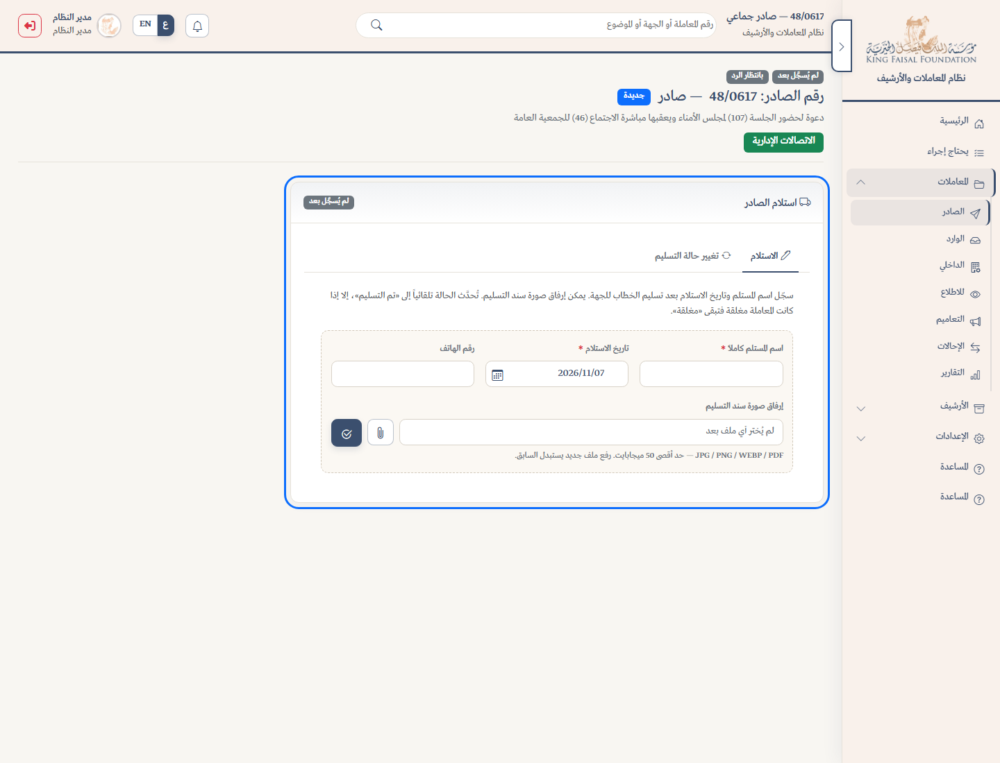

1. عرض الصادر ثم بطاقة **استلام الصادر**.
2. اسم المستلم كاملاً + تاريخ الاستلام + هاتف اختياري + صورة سند اختيارية.
3. احفظ لتسجيل التسليم.

رفع سند جديد يستبدل السابق. يوجد تبويب لتصحيح حالة التسليم إدارياً.

---

## 14) الإحالة

**الإحالة** = تحويل المعاملة من قسم إلى قسم آخر داخل الجهة (ليست إرسالاً خارجياً).

### أين تُنشأ؟

من صفحة **عرض الوارد** أو **عرض الداخلي** — بطاقة **سجل الإحالات** أسفل الصفحة.

(الصادر لا يُحال بهذه البطاقة؛ مساره الإصدار والتسليم.)

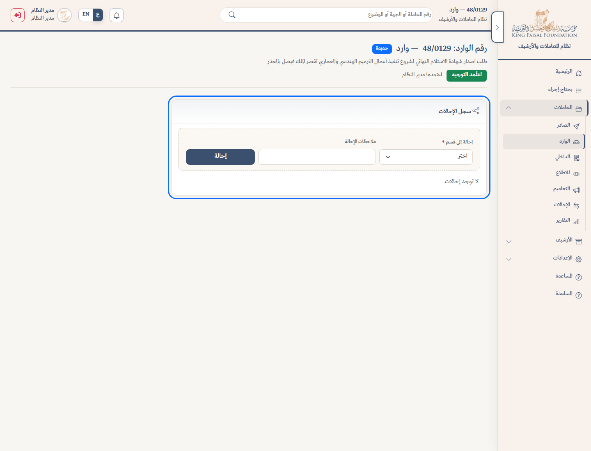

### خطوات الإحالة

1. افتح الوارد أو الداخلي.
2. انزل إلى بطاقة **سجل الإحالات**.
3. اختر **إحالة إلى قسم**.
4. اكتب **ملاحظات الإحالة** إن لزم.
5. اضغط **إحالة**.

بعدها تصبح حالة المعاملة محالة، وينتقل اختصاص المتابعة للقسم المستلم، ويُشعَر المعنيون.

### استلام الإحالة

القسم المستلم يرى الإحالة بحالة بانتظار، ثم من البطاقة أو من قائمة **الإحالات** يضغط **استلام**.

### قائمة الإحالات

من القائمة الجانبية: **الإحالات** — جدول بكل الإحالات (المعاملة، من، إلى، بواسطة، التاريخ، الحالة) مع فلتر الحالة وطباعة/تصدير.

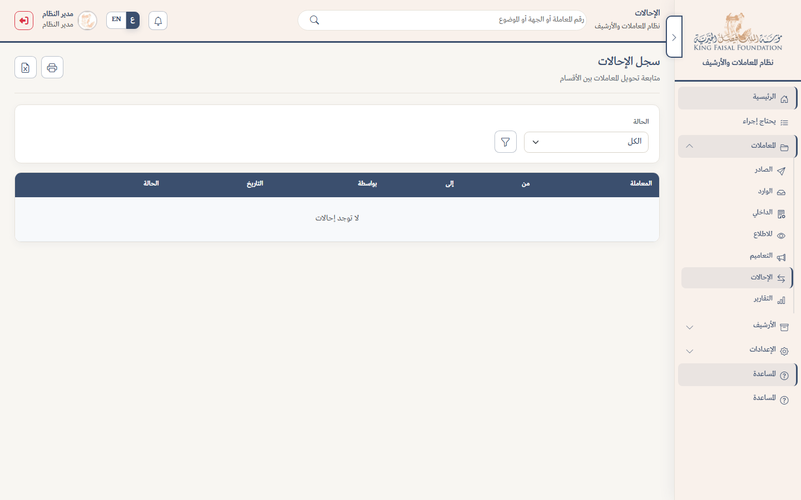

### الداخلي

عند **حفظ وإحالة** معاملة داخلية تُنشأ إحالة تلقائية للقسم المستلم. يمكن لاحقاً إحالة إضافية بنفس البطاقة.

لا تُحال معاملة مغلقة أو معلّقة في الاعتماد حتى يُرفع القيد.

---

## 15) التعليقات

من بطاقة **التعليقات والملاحظات الإدارية**: اختر تعليقاً سريعاً أو اكتب نصاً ثم **إضافة تعليق**. لا يغيّر الحالة وحده.

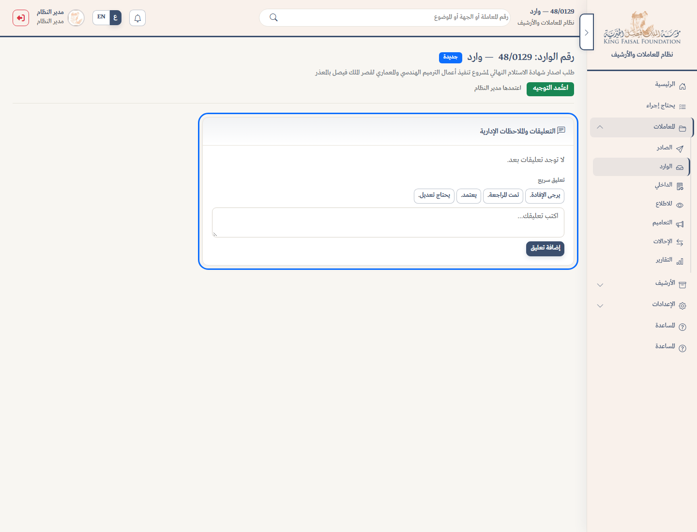

---

## 16) ورقة العرض (وارد وداخلي)

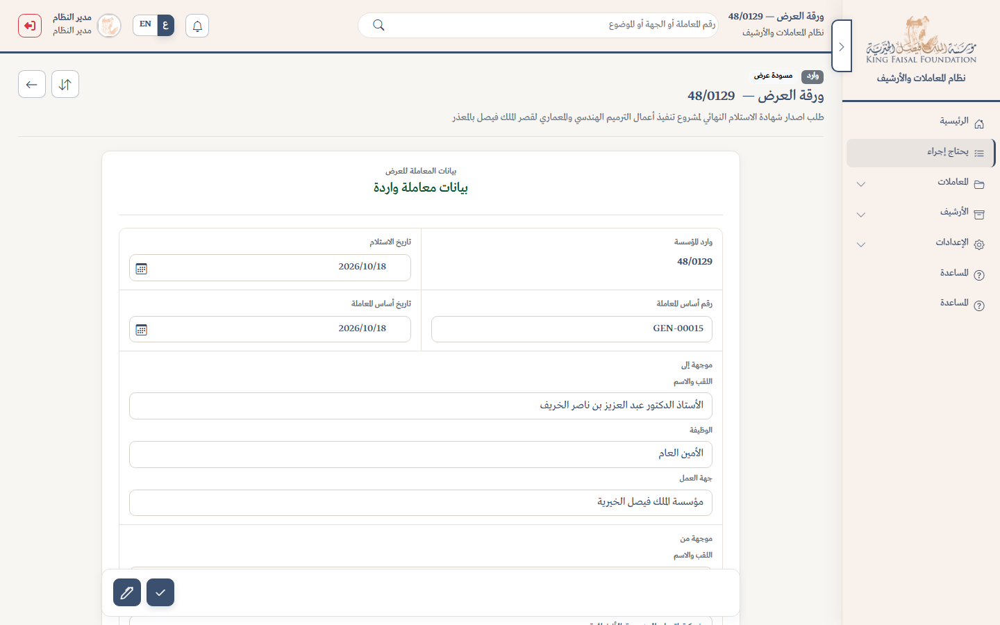

1. من عرض **الوارد** أو **الداخلي**: **إنشاء ورقة عرض**.
2. عبّئ الدراسة والتوصية والتوجيه والمعتمِد.
3. حفظ ثم **تسجيل التوجيه** عند الاعتماد.
4. طباعة أو تصدير ورد.

لا تغيّر رقم المعاملة ولا حالتها. الحالات: مسودة عرض / مُؤشَّر عليها. (غير متاحة للصادر.)

---

## 17) الطباعة وملصق الظرف والملصق الحراري وQR

من عرض المعاملة: بطاقة **ملصق حراري** مع رقم المعاملة ورمز الاستجابة السريعة.

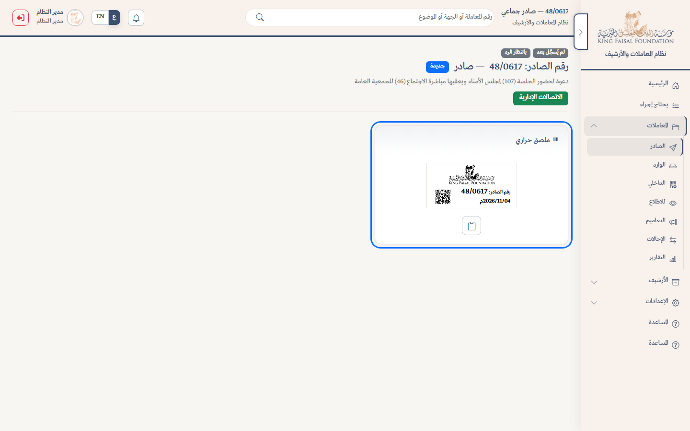

### شريط أزرار صفحة العرض

من عرض الوارد أو الصادر أو الداخلي (ونتائج الصادر الجماعي):

1. رجوع و**طباعة (القائمة)** ظاهران دائماً.
2. قائمة **طباعة** تضم: نموذج التسليم/الاستلام، ملصق الظرف، والملصق الحراري (ونموذج الإقفال عند الحاجة).
3. على الجوال: باقي الأزرار خلف **المزيد**.
4. الإجراءات الحساسة (**إقفال** / **إلغاء** / **تعديل**) في مجموعة منفصلة بلون أوضح.
5. بجانب العنوان تظهر **شارة الحالة** (مثل مقفلة / ملغاة / محالة).

### طباعة المعاملة

1. من صفحة العرض افتح قائمة **طباعة**.
2. اختر **طباعة نموذج التسليم** (صادر/داخلي) أو **طباعة نموذج الاستلام** (وارد).
3. راجع الرقم والموضوع وبطاقة التوجيه وQR.
4. اختر ورقاً مناسباً (غالباً **A4**) في نافذة الطباعة.

### ملصق الظرف (ستيكرز)

من قائمة **طباعة** ثم **ملصق الظرف** (وارد / صادر / داخلي، أو من نتائج الدفعة):

1. افتح **ملصق الظرف**.
2. اختر **قالب الورقة** (Letter 8.5x11)، مثلاً:
 - 10 ملصقات (2x5) — شائع
 - 8 ملصقات (2x4)
 - ملصق واحد كبير
3. حدّد **البدء من الملصق** لاستكمال ورقة مستخدمة جزئياً دون هدر باقي الملصقات.
4. **عدد النسخ**: يكرر نفس الملصق في الخانات التالية **على نفس الورقة فقط**.
5. اضغط **تطبيق** لتحديث المعاينة.
6. اضبط عند الحاجة:
 - **نوع الخط** (Greta، Tajawal، …) — ينعكس على الاسم والتذييل (التاريخ ورقم المعاملة).
 - **حجم الحقول %** لكل من: اللقب، الاسم، الوظيفة، جهة العمل/القسم.
7. **طباعة** — ورق Letter؛ الهوامش مضمّنة في القالب (مثل أعلى/أسفل 12 مم، يمين/يسار 5 مم، فراغ بين العمودين 2 مم للقالب 2x5).

محتوى الملصق: بيانات المستلم/المرسل حسب النوع (وفي الداخلي: بيانات **القسم المستلم**) + التاريخ ورقم المعاملة. الموضوع لا يُطبع على الملصق.

### ملصق حراري (حفظ فيزيائي)

لوضع رقم المعاملة على الملف الورقي — **ليس** ملصق الظرف. من قائمة **طباعة** اختر **طباعة ملصق حراري**.

1. اختر **القالب**: 50x25 ملم أو 44x22 ملم.
2. حدّد **عدد النسخ** (1–20). كل نسخة صفحة مستقلة بمقاس الملصق.
3. **طباعة** — في نافذة الطابعة اختر المقاس المطابق للملصق.

المحتوى: رقم المعاملة، التاريخ الهجري ثم الميلادي، وQR. لا يُطبع النوع ولا الموضوع.

### رمز QR

من لوحة QR على صفحة العرض: **نسخ الرقم**، **نسخ QR**، **تنزيل QR** للتحقق الخارجي.

---

## 18) إلغاء / سحب الصادر

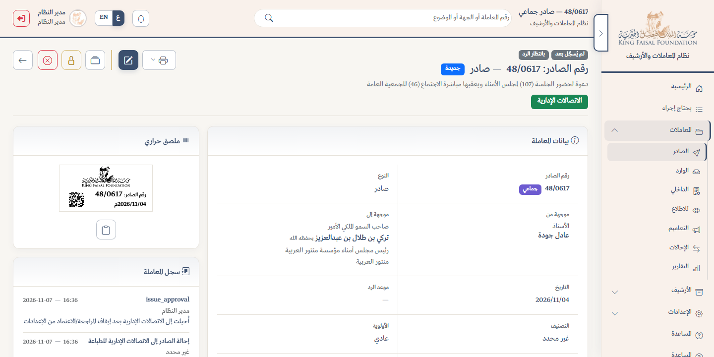

من عرض الصادر اختر **إلغاء / سحب** عند الحاجة لوقف المعاملة (لا يمكن التراجع).

| النوع | متى؟ |
|------|------|
| **ملغى** | لم يُعتمد الإرسال — الرقم محجوز ولا يُعاد استخدامه |
| **مسحوب** | سُحب بعد الإصدار أو التسليم — الرقم يبقى في السجل |

اكتب سبب الإلغاء ثم أكّد. بعد ذلك: لا تعديل ولا إرسال؛ التحقق يظهر المعاملة غير سارية؛ في الدفعة لا تُطبع الخطابات الملغاة. غير متاح للوارد أو الداخلي.

---

## 19) إغلاق المعاملة

إقفال المعاملة ثم الإجراء والنتيجة والمرفقات ثم حفظ (حالة **مغلقة**) ثم طباعة نموذج الإغلاق من قائمة **طباعة** أو شريط الإجراءات عند الحاجة.

بعد الإقفال يظهر في صفحة العرض **ملخص الإقفال** مع رابط نصي **عرض التفاصيل**. ينطبق على الوارد والصادر والداخلي حسب الصلاحية.

---

## 20) يحتاج إجراء

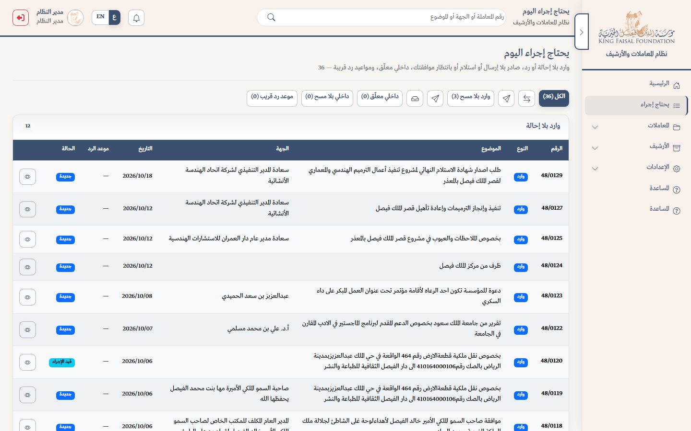

هذه الصفحة **ليست** إقفالاً جماعياً. راجعها يومياً: المعاملة تظهر لأن خطوة ناقصة، وتخرج عندما تُستكمل تلك الخطوة أو عندما تُقفل / تُلغى.

**إقفال رسمي** من بطاقة المعاملة ثم إقفال المعاملة: اكتب الإجراء المتخذ، اختر النتيجة (منتهية / تم التنفيذ / للحفظ)، ثم أكّد. الحالة تصبح **مغلقة** فتخرج من كل القوائم.

| القائمة | الإجراء المتبع | أو الإقفال |
|---------|----------------|------------|
| **وارد بلا إحالة** | أنشئ إحالة من بطاقة الوارد، أو غيّر الحالة من «جديدة / قيد الإجراء» | إقفال المعاملة |
| **وارد بلا رد صادر** | أنشئ رداً صادراً مربوطاً بهذا الوارد، أو اربط صادراً قائماً | إقفال أو وصول الحالة إلى «تم الرد» |
| **وارد بلا مسح** | ارفع المسح / المرفق من بطاقة الوارد | إقفال أو إخراجها من الحالات المفتوحة |
| **صادر بلا إرسال** | أرسل الخطاب (بريد / واتساب / تسجيل إرسال) | إقفال أو تسليم أو إلغاء |
| **صادر بلا استلام** | سجّل الاستلام (الاسم والتاريخ) بعد مدة التنبيه (افتراضي 7 أيام) | إقفال أو تسليم أو إلغاء |
| **داخلي معلّق** | أكمل مسارها؛ تخرج عند: تم الرد / تم التسليم / مغلقة / ملغاة | الإقفال هو المسار المعتاد |
| **داخلي بلا مسح** | ارفع المرفق | إقفال أو إخراجها من الحالات المفتوحة |
| **موعد رد قريب** | أنجز الرد أو التسليم (الموعد خلال اليوم أو يومين) | إقفال / إلغاء / تسوية الحالة |

المعاملة الواحدة قد تظهر في أكثر من قائمة. يكفي علاج السبب، أو الإقفال لإخراجها من الكل.

مرجع إضافي: [22-actions-queue.md](22-actions-queue.md).

---

## 21) التقارير

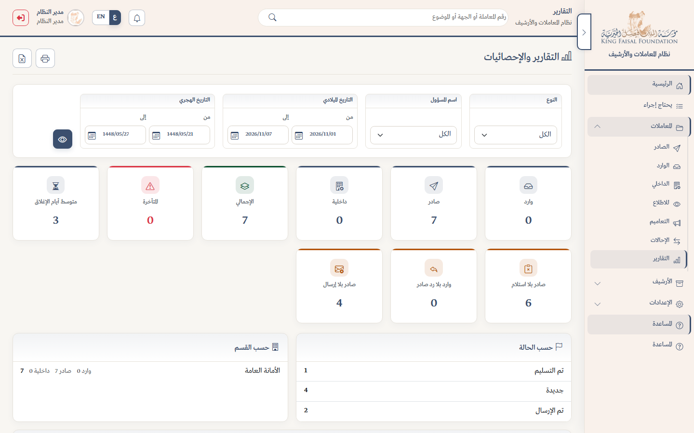

### الفلترة

نوع (الكل / وارد / صادر / **داخلي**) + قسم + فترة ثم **عرض** 
يظهر: إحصاءات، توزيع حالة/قسم، جدول تفاصيل.

### طباعة

طباعة من أعلى الصفحة (قد تُحدّ السجلات).

### تصدير Excel

نفس الفلاتر ثم **تصدير Excel** (الرقم، النوع، الموضوع، الجهة، التاريخ، موعد الرد، الحالة، القسم).

---

## 22) التعاميم

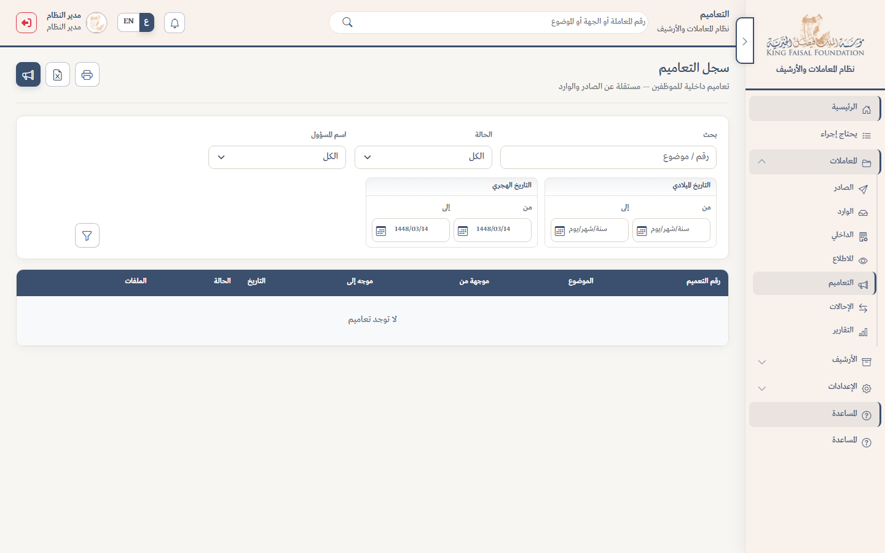

- **مشرف القسم:** عرض وطباعة التعاميم الموجّهة لقسمه أو للجميع.
- **مشرف الأرشيف:** تعميم جديد ثم مسودة أو إصدار داخلياً + مرفق + جمهور (الجميع أو أقسام).

مستقل عن الصادر/الوارد/الداخلي.

---

## 23) جهات المراسلة

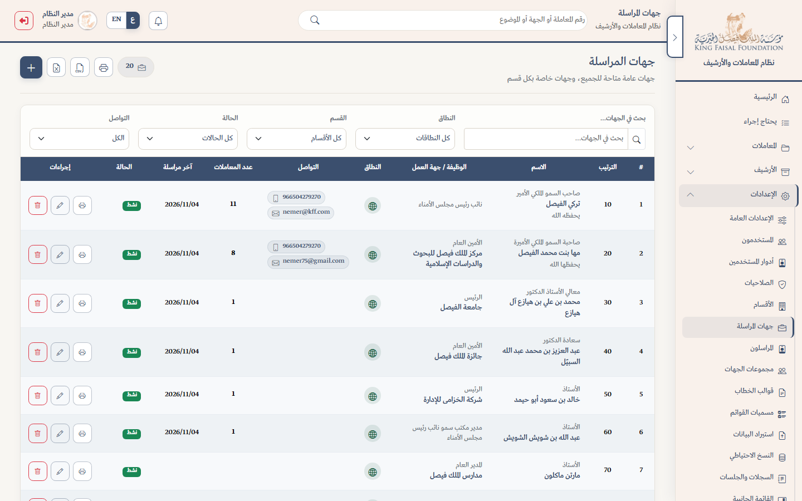

جهة جديدة (لقسمك) ثم اسم عربي + لقب/تكريم/تواصل. التكريم الافتراضي مثل **يحفظه الله** / **يحفظها الله**. الجهات العامة للعرض/الاستخدام عادة. لا تحذف جهة مرتبطة — عطّلها. صحّح الجوال والبريد قبل الإرسال.

إدارة **قائمة** عبارات التكريم (إضافة/تعديل) من **مسميات القوائم ثم التكريم** لمدير النظام فقط. اختيار التكريم على بطاقة الجهة متاح لمن يعدّل الجهات.

تعديل بطاقة الجهة يُطبَّق على **المعاملات الجديدة فقط**؛ المعاملات السابقة تبقى بالأسماء كما حُفظت وقت إنشائها (مع ترحيل صياغة التكريم القديمة عند الترقية).

---

## 24) مجموعات الجهات

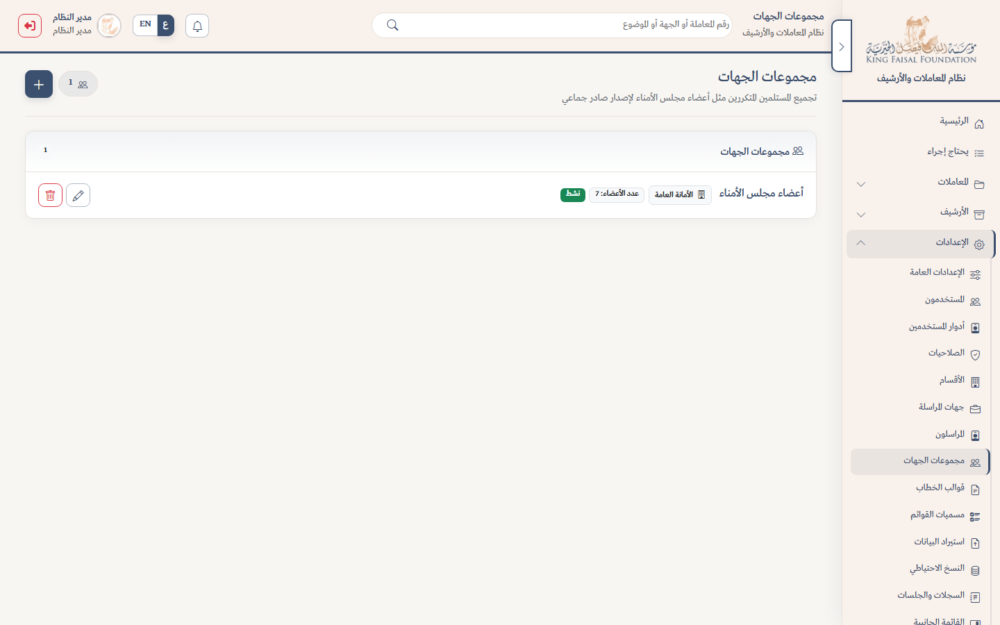

مجموعة جديدة ثم أعضاء ثم حفظ. تُستخدم في الصادر الجماعي. يلزم قسم على الحساب.

---

## 25) قوالب الخطاب

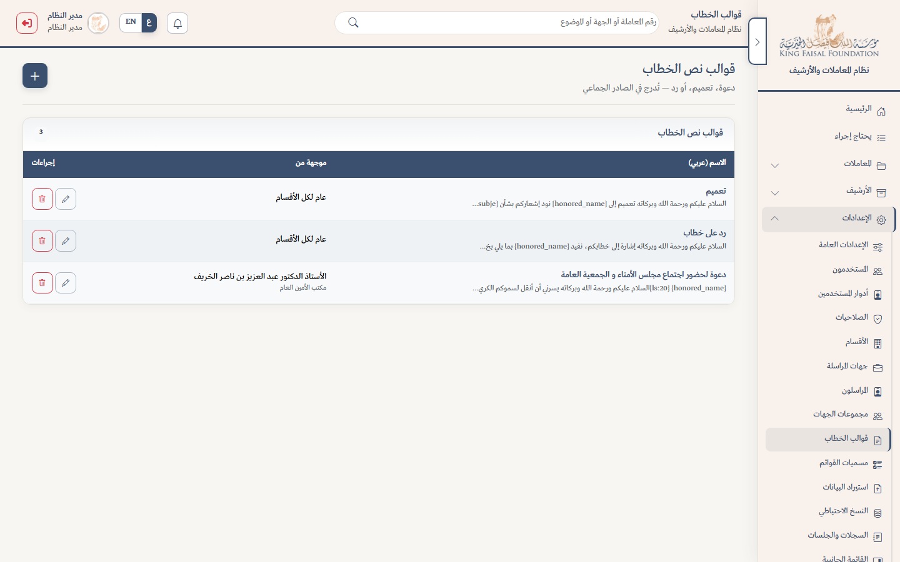

قالب جديد ثم نص + حقول المستلم ثم معاينة ثم حفظ ثم **إدراج قالب** لاحقاً في الجماعي/الخطاب.

---

## 26) التحقق بـ QR

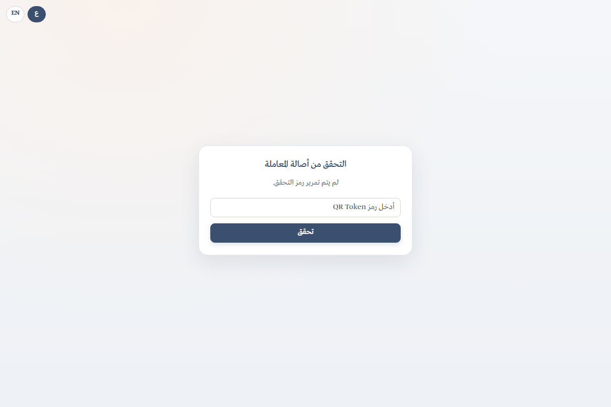

صفحة عامة بمسح QR أو إدخال الرمز: أصالة المعاملة والرقم والنوع؛ وقد يظهر النص أو RSVP. بدون المرفقات السرية. تبديل ع/EN متاح.

---

## 27) الملف الشخصي

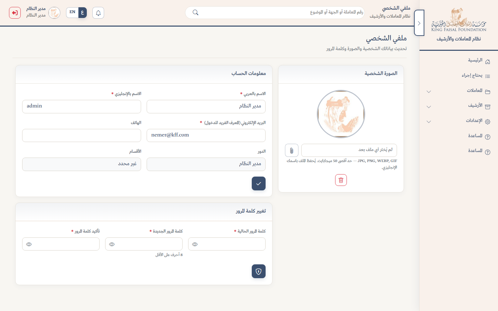

الاسم والصورة وتغيير كلمة المرور. البريد معرف الدخول. اللغة من الشريط العلوي.

---

## 28) نصائح

- الدخول بالبريد فقط؛ لا تشارك كلمة المرور.
- راجع «يحتاج إجراء» والجرس يومياً (وارد / صادر / داخلي).
- من جهاز مشترك: **خروج**.
- للتصدير الشامل: التقارير ثم Excel.
- لا تُلغِ صادراً إلا بعد التأكد — الإلغاء لا يُراجع والرقم يبقى محجوزاً.
- في ملصق الظرف: ابدأ من الخانة الصحيحة واطبع بورق Letter حسب القالب.
- في الملصق الحراري: اختر مقاس الطابعة المطابق للقالب (50x25 أو 44x22 ملم).
- للمساعدة أو إعادة الدعوة: مدير النظام.
