# دليل المستخدم الشامل — نظام الصادر والوارد والداخلي

> نسخة قابلة للطباعة والإرسال: [user-guide.html](user-guide.html)

دليل للمستخدم النهائي (مشرف القسم / مشرف الأرشيف / مشاهد). إعدادات الإدارة خارج نطاق هذا الدليل.

---

## 1) تسجيل الدخول

1. افتح رابط النظام من رسالة الدعوة.
2. أدخل **البريد الإلكتروني** (اسم الدخول).
3. أدخل **كلمة المرور**.
4. اضغط **دخول**.
5. من **ملفي الشخصي** غيّر كلمة المرور في أول دخول.

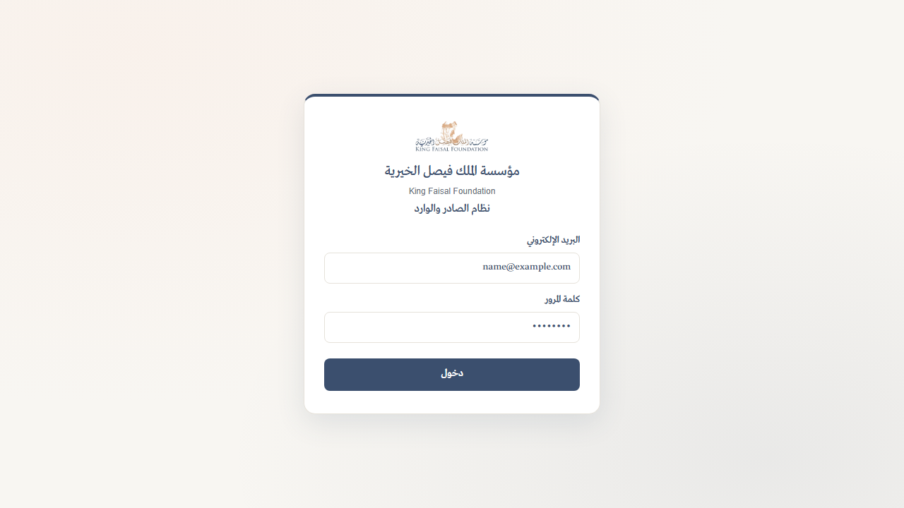

**نسيت كلمة المرور؟** استخدم الرابط أسفل حقل كلمة المرور.

---

## 2) الشريط العلوي

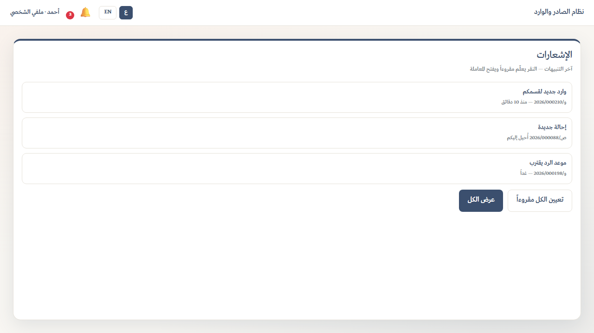

- **ع / EN** — تبديل لغة الواجهة فوراً.
- **جرس الإشعارات** — وارد جديد، إحالة، اقتراب موعد الرد. النقر يعلّم مقروءاً ويفتح الرابط.
- **عرض الكل** / **تعيين الكل مقروءاً** من قائمة الإشعارات.
- الملف الشخصي و**خروج**.

---

## 3) الصفحة الرئيسية

- إحصاءات **الصادر** و**الوارد** و**الداخلي** (إن ظهرت لك في القائمة)
- يحتاج إجراء / آخر المعاملات / المتأخر — لكل نوع ظاهر
- روابط سريعة: تعاميم، إحالات، أرشيف، تقارير، مرفقات
- زر سريع **داخلي جديد** عند توفر الصلاحية

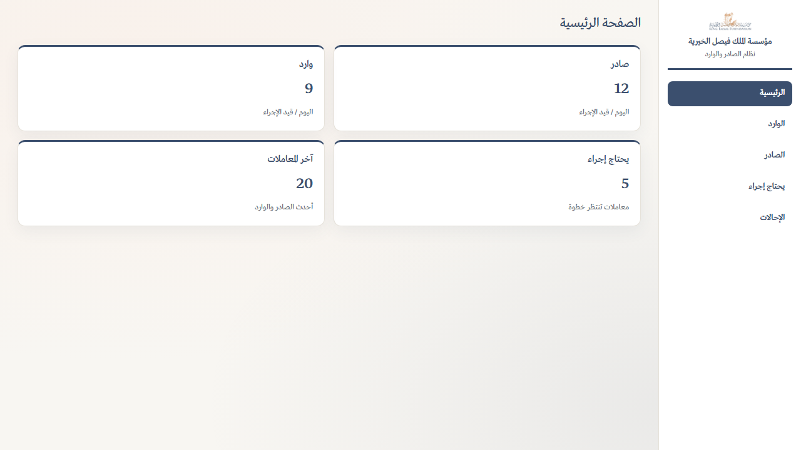

تظهر المعاملات حسب القسم والصلاحيات.

---

## 4) القائمة الجانبية

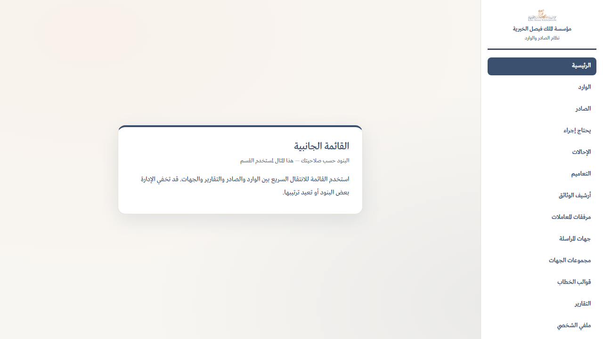

| القائمة | الاستخدام |
|---------|-----------|
| الرئيسية | الملخص والمتابعات |
| الوارد | تسجيل ومتابعة الوارد |
| الصادر | إنشاء ومتابعة الصادر |
| المعاملات الداخلية | مراسلات بين الأقسام مع إحالة تلقائية |
| يحتاج إجراء | ما ينتظر خطوة |
| الإحالات | بين الأقسام |
| التعاميم | التعاميم الداخلية |
| أرشيف الوثائق | وثائق أرشيفية |
| مرفقات المعاملات | فهرس المرفقات والبحث |
| جهات المراسلة | بيانات الجهات |
| مجموعات الجهات | مستلمون متكررون |
| قوالب الخطاب | نصوص جاهزة |
| التقارير | إحصاءات وتصدير Excel |
| ملفي الشخصي | الاسم والصورة وكلمة المرور |

قد يُخفى بند **المعاملات الداخلية** من الشريط الجانبي إذا أخفاه المدير من **إدارة القائمة الجانبية** (إخفاء عام للجميع)، أو إذا أُلغي ظهوره لبعض الأدوار من تعديل العنصر.

---

## 5) البحث والفلترة في القوائم

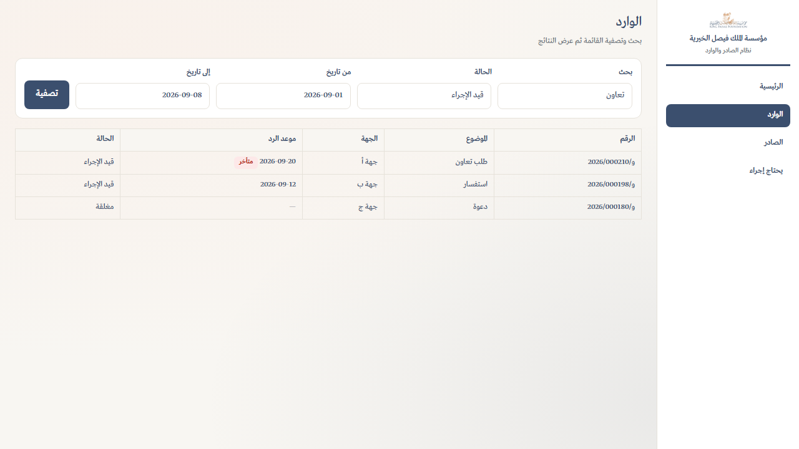

من **الوارد** أو **الصادر** أو **المعاملات الداخلية**:

| الفلتر | المعنى |
|--------|--------|
| بحث | رقم / موضوع / جهة أو قسم |
| الحالة | مثل جديدة أو قيد الإجراء أو مغلقة |
| يحتاج متابعة | ما ينتظر إجراءً |
| القسم | حسب الصلاحية |
| الفترة | من/إلى (ميلادي أو هجري) |
| الاستلام (صادر) | بدون استلام / تم التسجيل / متأخر |

تصدير Excel للقوائم من **التقارير** وليس من قوائم المعاملات.

---

## 6) الصادر (مفرد)

1. **الصادر** ← صادر جديد.
2. الموضوع + الجهة المستلمة + القسم/التوقيع + التاريخ + أولوية/سرية.
3. أرفق ملفاً إن لزم ثم احفظ.
4. من العرض: إرسال، استلام، قائمة **طباعة** (نموذج التسليم / ملصق الظرف / ملصق حراري)، إحالة، تعليقات، ربط بوارد؛ وإقفال / **إلغاء / سحب** من مجموعة الإجراءات الحساسة. على الجوال: الأزرار الثانوية خلف **المزيد**.

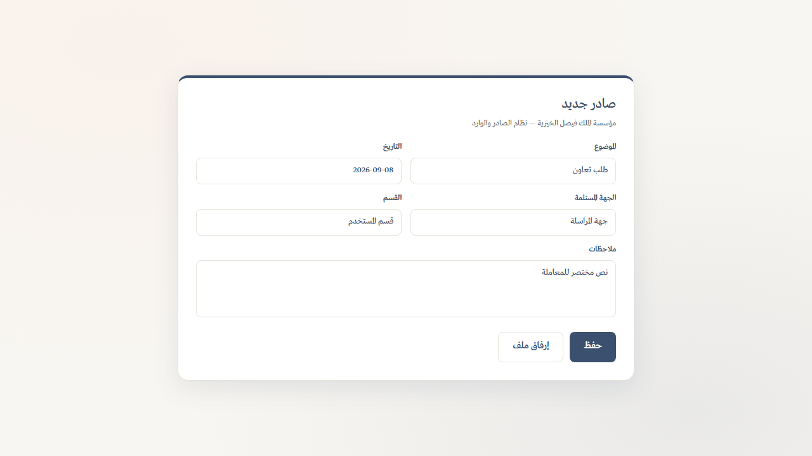

يمكن إدخال «مرجع وارد» كنص خارجي دون ربط تلقائي بسجل وارد.

### المراجعة والاعتماد قبل الإصدار

إذا فعّل مدير النظام موافقة الصادر، لا يُطبع الصادر ولا يُرسل قبل اعتماده. وإذا فعّل مرحلة المراجعة، يمرّ الصادر بالمراجعة أولاً.

1. من صفحة العرض: **إرسال للمراجعة** (أو **طلب موافقة الإصدار** إن كانت المراجعة غير مفعّلة).
2. يصل إلى **المراجع الأول** ويظهر عنده في «يحتاج إجراء» ← **يحتاج مراجعة**. إذا انتهت مهلته دون قرار يُحوَّل إلى **المراجع الثاني**.
3. المراجع: **مطابقة — إحالة للاعتماد** فينتقل إلى المعتمد الأول، أو **إعادة بملاحظات** فيرجع إليك للتصحيح ثم **إعادة الإرسال للمراجعة**.
4. بعدها يعتمد المعتمدون بالتسلسل (الأول، ثم الثاني بعد مهلته، ثم الثالث بسبب إلزامي)، ثم يصبح الصادر جاهزاً للإصدار.

**ما يُراجَع:** البيانات، والجهة، والمرفقات، والصيغة.

**قرارات المراجع:** مطابقة ← بانتظار الاعتماد، أو إعادة بملاحظات ← المسودة.

**الضوابط:**

- المراجعة للشكل والإجراء فقط، والمضمون والقرار للمعتمد.
- الإعادة تكون بملاحظات مكتوبة إلزامية.
- من أعدّ المعاملة لا يراجعها، ومن راجعها لا يعتمدها.
- أي تعديل بعد المراجعة يعيد المعاملة للمراجعة.
- تعمل المراجعة ضمن مسار موافقة الإصدار، فيلزم تفعيله وتحديد المعتمد الأول.
- إن لم يوجد مراجع مؤهَّل (غير المُعِدّ) تنتقل المعاملة مباشرة إلى المعتمد الأول.

يحدد مدير النظام المراجع الأول والثاني والمهلة من الإعدادات ← الصادر. إن تُركا فارغين يراجع أي مستخدم من «الاتصالات الإدارية».

---

## 7) صادر جماعي

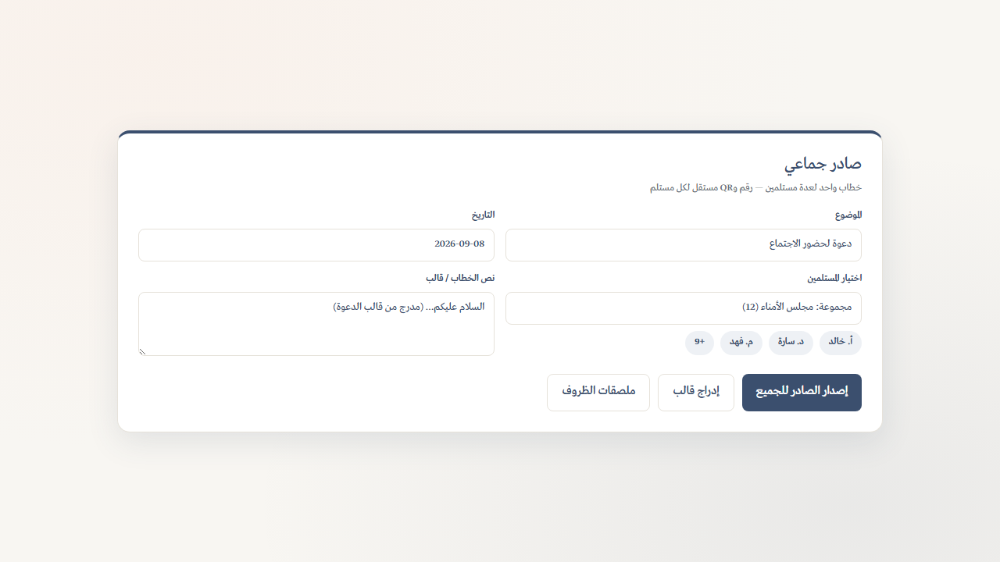

1. الصادر ← **صادر جماعي**.
2. موضوع + اختيار مستلمين (مجموعة أو يدوي).
3. تاريخ وقسم وأولوية وسرية + نص/قالب اختياري.
4. أكّد **إصدار الصادر للجميع** (رقم وQR لكل مستلم).
5. من النتائج: مجموعة إرسال (بريد / واتساب / تسليم)؛ قائمة **طباعة** (نموذج التسليم / الخطابات / الملصقات / حراري / كشف المرسل إليهم)؛ تصدير Word/CSV من الشريط أو من **المزيد** على الجوال.

---

## 8) الوارد

### تسجيل وارد جديد

1. **الوارد** ← وارد جديد.
2. الموضوع وتاريخ الاستلام والجهة المرسلة.
3. **رقم خطاب الجهة** (رقمهم الخارجي).
4. اختياري: **ربط بصادر**.
5. القسم وموعد الرد والأولوية/السرية ثم احفظ.
6. المرفق اختياري عند الحفظ (مثلاً ظرف مغلق) — ارفع المسح لاحقاً من صفحة العرض.

| الحقل | المعنى |
|------|--------|
| الجهة المرسلة | من أرسل الخطاب إليكم |
| رقم خطاب الجهة | رقمهم الخارجي |
| ربط بصادر | علاقة داخل النظام |
| موعد الرد | آخر موعد متوقع للرد |
| رقم الوارد | يُنشأ تلقائياً |
| المرفق | اختياري الآن؛ يُرفع لاحقاً إن لزم |

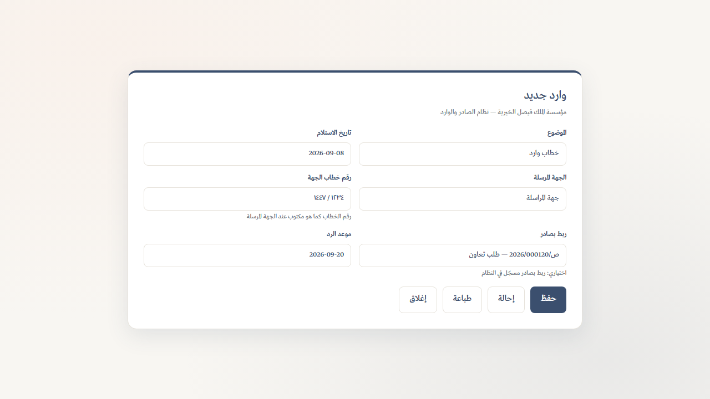

### متابعة بعد الحفظ

رفع مرفقات، إحالة، تعليقات، ورقة عرض، **إنشاء رد**، قائمة **طباعة** (نموذج الاستلام / ملصق الظرف / ملصق حراري) حتى الإغلاق.

---

## 9) المعاملات الداخلية

المعاملات الداخلية لمراسلات **بين الأقسام** داخل الجهة (ليست جهة خارجية). عند الحفظ تُنشأ إحالة تلقائية للقسم المستلم.

### إنشاء معاملة داخلية

1. **المعاملات الداخلية** ← **معاملة داخلية جديدة** (أو من الرئيسية: داخلي جديد).
2. أدخل **الموضوع**.
3. حدّد مسار المعاملة: **من قسم** → **إلى قسم** (لا يجوز أن يكونا نفس القسم).
4. التاريخ، موعد الرد إن لزم، الأولوية والسرية، وملاحظات اختيارية.
5. أرفق ملفاً اختياريًا ثم **حفظ وإحالة**.
6. يُمنح رقماً تلقائياً ببادئة الداخلي (غالباً مثل: د/2026/…) وتُحال للقسم المستلم.

### القائمة والعرض

- القائمة تعرض: الرقم، الموضوع، **من → إلى**، التاريخ، موعد الرد، القسم المستلم، الحالة.
- من صفحة العرض: قائمة **طباعة** (نموذج التسليم / ملصق الظرف / ملصق حراري)، ورقة عرض، مرفقات، تعليقات، إحالات، تغيير الحالة، إقفال.
- على الجوال: الأزرار الثانوية خلف **المزيد**؛ والإجراءات الحساسة (إقفال / تعديل) في مجموعة منفصلة.
- أسماء مديري الأقسام (الموجّه من / إلى) تُحفظ مع المعاملة عند الإنشاء؛ تعديل بطاقة القسم لاحقاً لا يغيّر المعاملات القديمة.
- **لا يوجد** تعديل للقيد بعد الإنشاء من الواجهة، و**لا يوجد** إلغاء/سحب (خاص بالصادر فقط).

| مقارنة سريعة | داخلي | وارد | صادر |
|---|---|---|---|
| الطرف | قسم → قسم | جهة خارجية | جهة خارجية |
| عند الحفظ | إحالة تلقائية للمستلم | تسجيل وارد | إعداد/إرسال |
| ورقة العرض | نعم | نعم | لا |
| ملصق الظرف | بيانات **القسم المستلم** | من الجهة | إلى الجهة |
| ملصق حراري | رقم + تواريخ + QR | نفس المحتوى | نفس المحتوى |
| إلغاء/سحب | لا | لا | نعم |

---

## 10) الأولوية والسرية

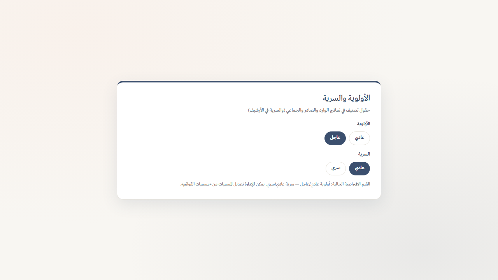

- أولوية افتراضية: عادي / عاجل
- سرية افتراضية: عادي / سري

تظهر في الوارد والصادر والداخلي والجماعي. يمكن للإدارة تعديل المسميات من **مسميات القوائم**. لا تغلقان المعاملة وحدهما.

---

## 11) المرفقات ومرفقات المعاملات

### الرفع من المعاملة

من عرض الوارد/الصادر/**الداخلي** ارفع **PDF أو صورة**. احذف الخاطئ بعد التأكيد.

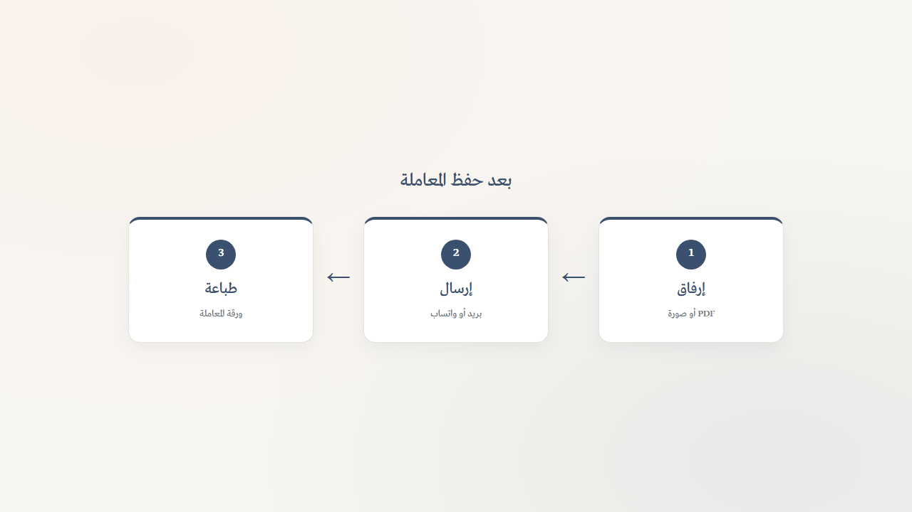

### قائمة مرفقات المعاملات

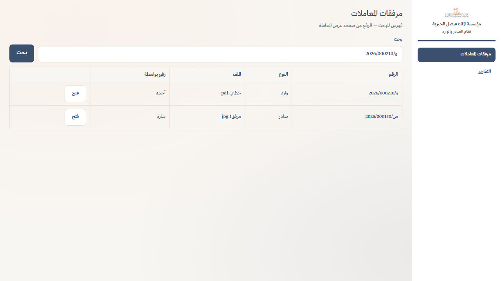

**مرفقات المعاملات** ← ابحث باسم الملف أو رقم المعاملة ← فتح الملف أو الانتقال للمعاملة.  
الرفع لا يتم من هذه الصفحة.

---

## 12) إرسال الصادر

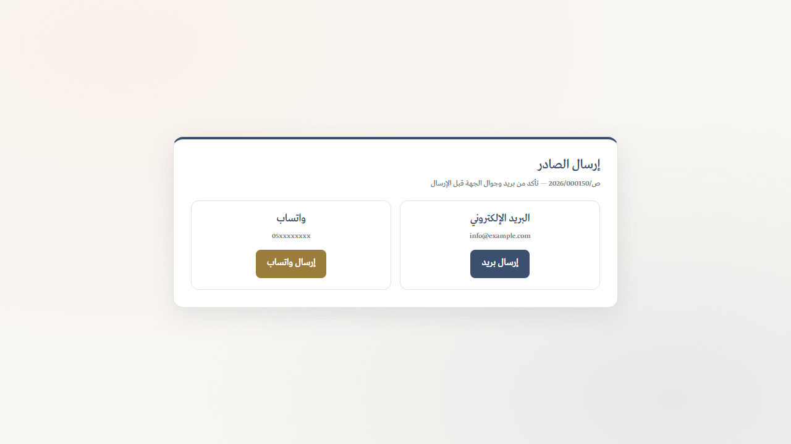

1. أكمل البيانات والمرفق.
2. من الصادر: بريد أو واتساب ثم أكّد.
3. في الجماعي: إرسال المحددين من صفحة النتائج.

تأكد من جوال/بريد الجهة قبل الإرسال. (الإرسال الخارجي خاص بالصادر وليس بالمعاملة الداخلية.)

---

## 13) تسجيل استلام الصادر

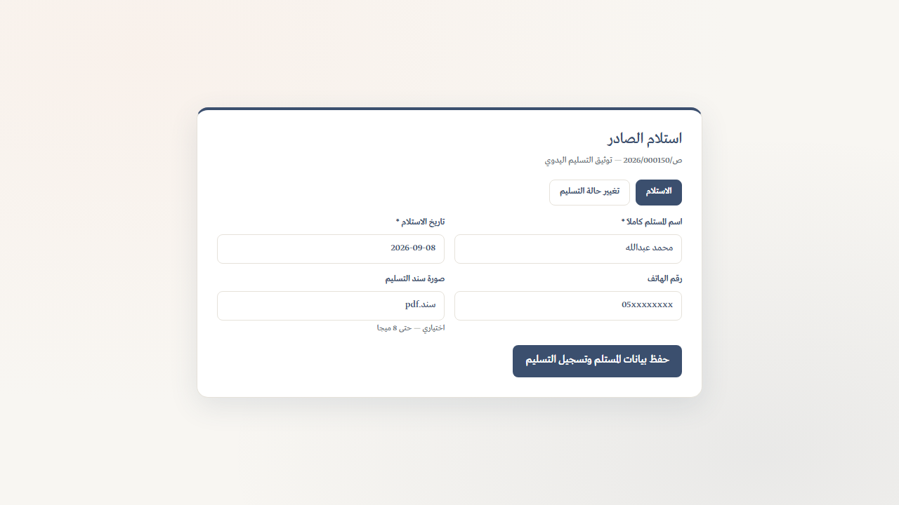

1. عرض الصادر ← **استلام الصادر**.
2. اسم المستلم كاملاً + تاريخ الاستلام + هاتف اختياري + صورة سند اختيارية.
3. احفظ لتسجيل التسليم.

رفع سند جديد يستبدل السابق. يوجد تبويب لتصحيح حالة التسليم إدارياً.

---

## 14) الإحالة

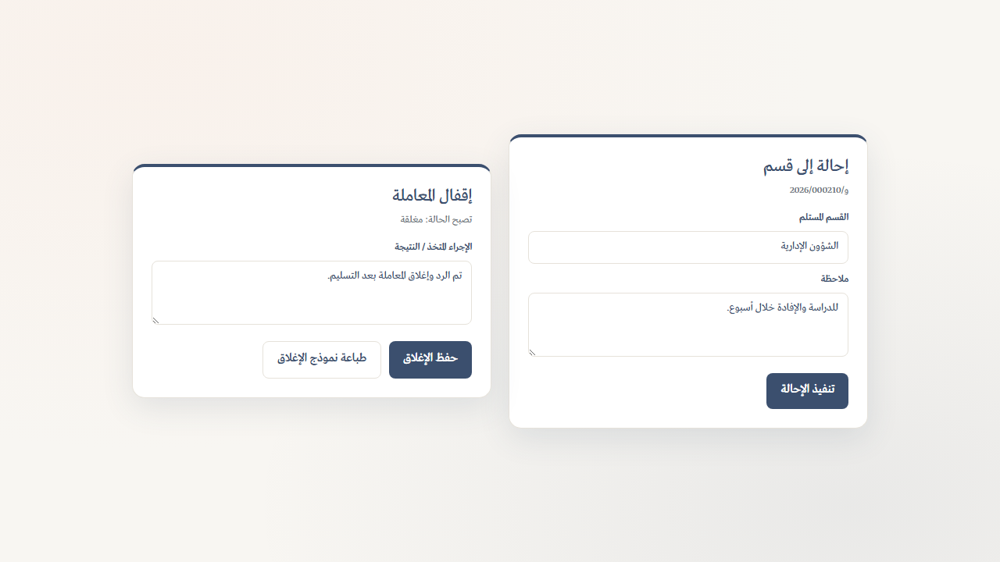

افتح المعاملة ← إحالة إلى قسم ← ملاحظة اختيارية ← نفّذ. تابع من **الإحالات**.  
في **الداخلي** تُنشأ إحالة تلقائية عند الحفظ للقسم المستلم؛ يمكن لاحقاً إحالة إضافية عند الحاجة.

---

## 15) التعليقات

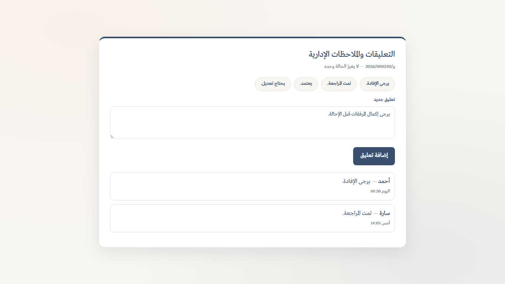

من بطاقة **التعليقات والملاحظات الإدارية**: اختر تعليقاً سريعاً أو اكتب نصاً ← **إضافة تعليق**.  
لا يغيّر الحالة وحده.

---

## 16) ورقة العرض (وارد وداخلي)

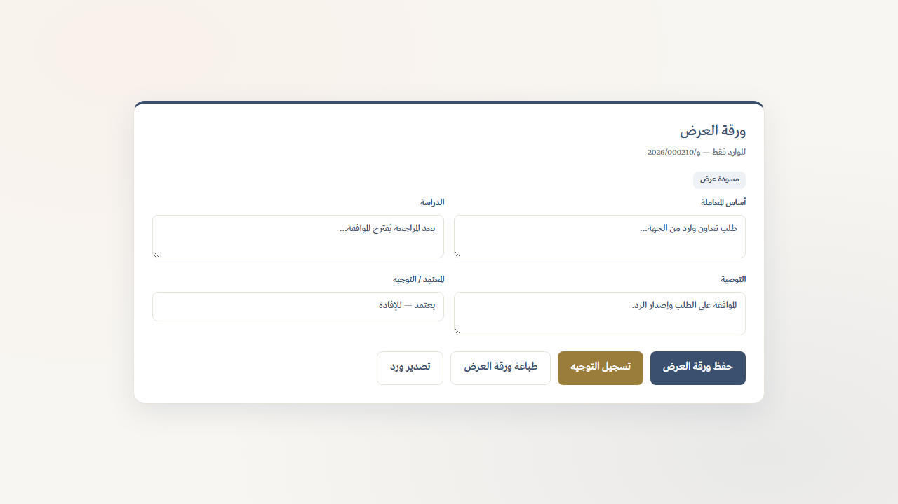

1. من عرض **الوارد** أو **الداخلي**: **إنشاء ورقة عرض**.
2. عبّئ الدراسة والتوصية والتوجيه والمعتمِد.
3. حفظ → **تسجيل التوجيه** عند الاعتماد.
4. طباعة أو تصدير ورد.

لا تغيّر رقم المعاملة ولا حالتها. الحالات: مسودة عرض / مُؤشَّر عليها. (غير متاحة للصادر.)

---

## 17) الطباعة وملصق الظرف والملصق الحراري وQR

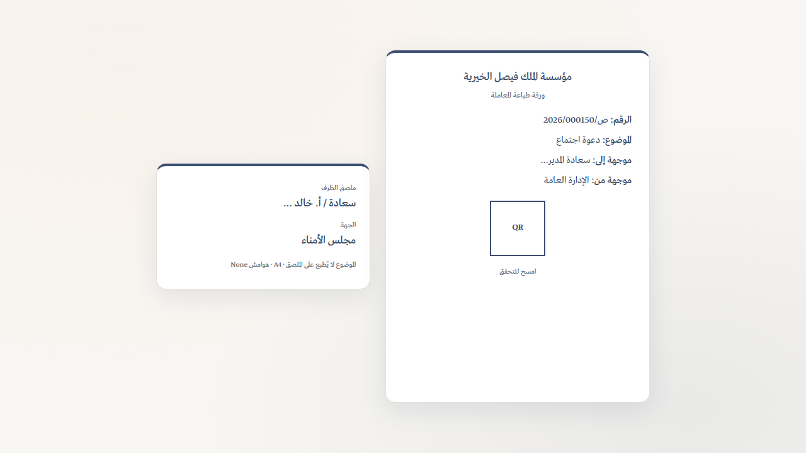

### شريط أزرار صفحة العرض

من عرض الوارد أو الصادر أو الداخلي (ونتائج الصادر الجماعي):

1. رجوع و**طباعة ▾** ظاهران دائماً.
2. قائمة **طباعة** تضم: نموذج التسليم/الاستلام، ملصق الظرف، والملصق الحراري (ونموذج الإقفال عند الحاجة).
3. على الجوال: باقي الأزرار خلف **المزيد**.
4. الإجراءات الحساسة (**إقفال** / **إلغاء** / **تعديل**) في مجموعة منفصلة بلون أوضح.
5. بجانب العنوان تظهر **شارة الحالة** (مثل مقفلة / ملغاة / محالة).

### طباعة المعاملة

1. من صفحة العرض افتح قائمة **طباعة**.
2. اختر **طباعة نموذج التسليم** (صادر/داخلي) أو **طباعة نموذج الاستلام** (وارد).
3. راجع الرقم والموضوع وبطاقة التوجيه وQR.
4. اختر ورقاً مناسباً (غالباً **A4**) في نافذة الطباعة.

### ملصق الظرف (ستيكرز)

من قائمة **طباعة** → **ملصق الظرف** (وارد / صادر / داخلي، أو من نتائج الدفعة):

1. افتح **ملصق الظرف**.
2. اختر **قالب الورقة** (Letter 8.5×11)، مثلاً:
   - 10 ملصقات (2×5) — شائع
   - 8 ملصقات (2×4)
   - ملصق واحد كبير
3. حدّد **البدء من الملصق** لاستكمال ورقة مستخدمة جزئياً دون هدر باقي الملصقات.
4. **عدد النسخ**: يكرر نفس الملصق في الخانات التالية **على نفس الورقة فقط**.
5. اضغط **تطبيق** لتحديث المعاينة.
6. اضبط عند الحاجة:
   - **نوع الخط** (Greta، Tajawal، …) — ينعكس على الاسم والتذييل (التاريخ ورقم المعاملة).
   - **حجم الحقول %** لكل من: اللقب، الاسم، الوظيفة، جهة العمل/القسم.
7. **طباعة** — ورق Letter؛ الهوامش مضمّنة في القالب (مثل أعلى/أسفل 12 مم، يمين/يسار 5 مم، فراغ بين العمودين 2 مم للقالب 2×5).

محتوى الملصق: بيانات المستلم/المرسل حسب النوع (وفي الداخلي: بيانات **القسم المستلم**) + التاريخ ورقم المعاملة. الموضوع لا يُطبع على الملصق.

### ملصق حراري (حفظ فيزيائي)

لوضع رقم المعاملة على الملف الورقي — **ليس** ملصق الظرف. من قائمة **طباعة** اختر **طباعة ملصق حراري**.

1. اختر **القالب**: 50×25 ملم أو 44×22 ملم.
2. حدّد **عدد النسخ** (1–20). كل نسخة صفحة مستقلة بمقاس الملصق.
3. **طباعة** — في نافذة الطابعة اختر المقاس المطابق للملصق.

المحتوى: رقم المعاملة، التاريخ الهجري ثم الميلادي، وQR. لا يُطبع النوع ولا الموضوع.

### رمز QR

من لوحة QR على صفحة العرض: **نسخ الرقم**، **نسخ QR**، **تنزيل QR** للتحقق الخارجي.

---

## 18) إلغاء / سحب الصادر

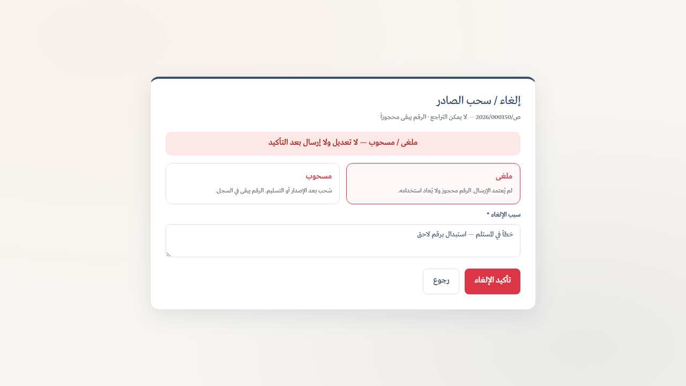

من عرض الصادر اختر **إلغاء / سحب** عند الحاجة لوقف المعاملة (لا يمكن التراجع).

| النوع | متى؟ |
|------|------|
| **ملغى** | لم يُعتمد الإرسال — الرقم محجوز ولا يُعاد استخدامه |
| **مسحوب** | سُحب بعد الإصدار أو التسليم — الرقم يبقى في السجل |

اكتب سبب الإلغاء ثم أكّد. بعد ذلك: لا تعديل ولا إرسال؛ التحقق يظهر المعاملة غير سارية؛ في الدفعة لا تُطبع الخطابات الملغاة. غير متاح للوارد أو الداخلي.

---

## 19) إغلاق المعاملة

إقفال المعاملة ← الإجراء والنتيجة والمرفقات ← حفظ (حالة **مغلقة**) ← طباعة نموذج الإغلاق من قائمة **طباعة** أو شريط الإجراءات عند الحاجة.

بعد الإقفال يظهر في صفحة العرض **ملخص الإقفال** مع رابط نصي **عرض التفاصيل**. ينطبق على الوارد والصادر والداخلي حسب الصلاحية.

---

## 20) يحتاج إجراء

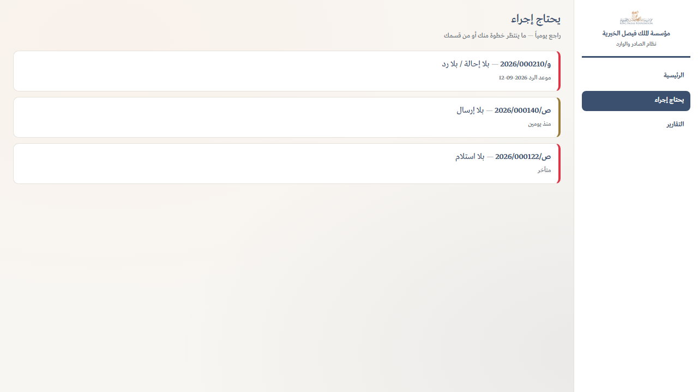

هذه الصفحة **ليست** إقفالاً جماعياً. راجعها يومياً: المعاملة تظهر لأن خطوة ناقصة، وتخرج عندما تُستكمل تلك الخطوة أو عندما تُقفل / تُلغى.

**إقفال رسمي** من بطاقة المعاملة → إقفال المعاملة: اكتب الإجراء المتخذ، اختر النتيجة (منتهية / تم التنفيذ / للحفظ)، ثم أكّد. الحالة تصبح **مغلقة** فتخرج من كل القوائم.

| القائمة | الإجراء المتبع | أو الإقفال |
|---------|----------------|------------|
| **وارد بلا إحالة** | أنشئ إحالة من بطاقة الوارد، أو غيّر الحالة من «جديدة / قيد الإجراء» | إقفال المعاملة |
| **وارد بلا رد صادر** | أنشئ رداً صادراً مربوطاً بهذا الوارد، أو اربط صادراً قائماً | إقفال أو وصول الحالة إلى «تم الرد» |
| **وارد بلا مسح** | ارفع المسح / المرفق من بطاقة الوارد | إقفال أو إخراجها من الحالات المفتوحة |
| **صادر بلا إرسال** | أرسل الخطاب (بريد / واتساب / تسجيل إرسال) | إقفال أو تسليم أو إلغاء |
| **صادر بلا استلام** | سجّل الاستلام (الاسم والتاريخ) بعد مدة التنبيه (افتراضي 7 أيام) | إقفال أو تسليم أو إلغاء |
| **داخلي معلّق** | أكمل مسارها؛ تخرج عند: تم الرد / تم التسليم / مغلقة / ملغاة | الإقفال هو المسار المعتاد |
| **داخلي بلا مسح** | ارفع المرفق | إقفال أو إخراجها من الحالات المفتوحة |
| **موعد رد قريب** | أنجز الرد أو التسليم (الموعد خلال اليوم أو يومين) | إقفال / إلغاء / تسوية الحالة |

المعاملة الواحدة قد تظهر في أكثر من قائمة. يكفي علاج السبب، أو الإقفال لإخراجها من الكل.

مرجع إضافي: [22-actions-queue.md](22-actions-queue.md).

---

## 21) التقارير

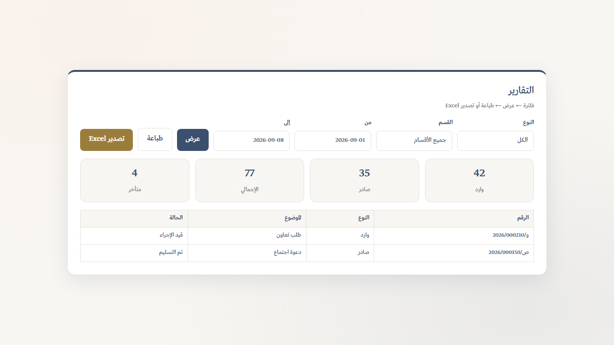

### الفلترة

نوع (الكل / وارد / صادر / **داخلي**) + قسم + فترة ← **عرض**  
يظهر: إحصاءات، توزيع حالة/قسم، جدول تفاصيل.

### طباعة

طباعة من أعلى الصفحة (قد تُحدّ السجلات).

### تصدير Excel

نفس الفلاتر ← **تصدير Excel** (الرقم، النوع، الموضوع، الجهة، التاريخ، موعد الرد، الحالة، القسم).

---

## 22) التعاميم

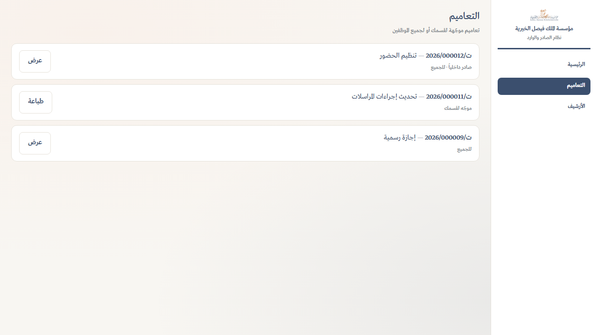

- **مشرف القسم:** عرض وطباعة التعاميم الموجّهة لقسمه أو للجميع.
- **مشرف الأرشيف:** تعميم جديد ← مسودة أو إصدار داخلياً + مرفق + جمهور (الجميع أو أقسام).

مستقل عن الصادر/الوارد/الداخلي.

---

## 23) أرشيف الوثائق

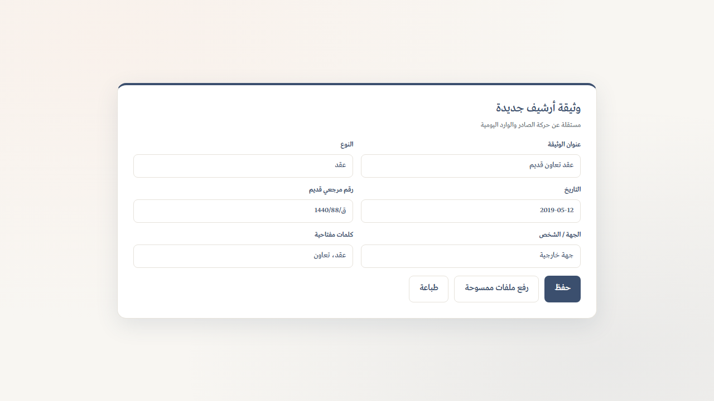

وثيقة جديدة ← عنوان ونوع وتاريخ وجهة ورقم قديم وكلمات مفتاحية + ملفات ← حفظ.  
لاحقاً: تعديل، رفع، بحث، طباعة. للوثائق التاريخية المستقلة عن الحركة اليومية.

---

## 24) جهات المراسلة

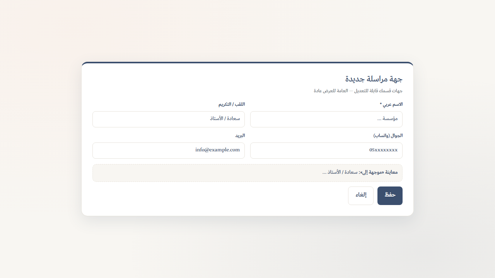

جهة جديدة (لقسمك) ← اسم عربي + تواصل. الجهات العامة للعرض/الاستخدام عادة. لا تحذف جهة مرتبطة — عطّلها. صحّح الجوال والبريد قبل الإرسال.

تعديل بطاقة الجهة يُطبَّق على **المعاملات الجديدة فقط**؛ المعاملات السابقة تبقى بالأسماء كما حُفظت وقت إنشائها.

---

## 25) مجموعات الجهات

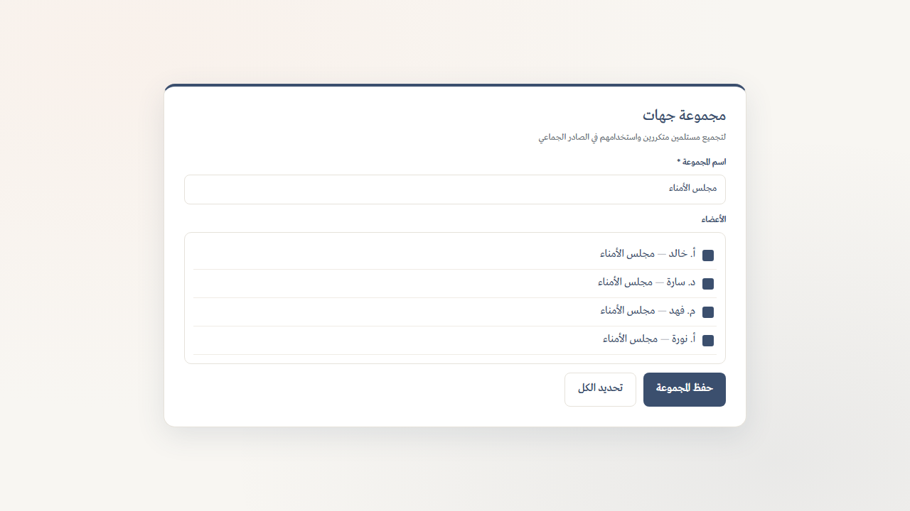

مجموعة جديدة ← أعضاء ← حفظ. تُستخدم في الصادر الجماعي. يلزم قسم على الحساب.

---

## 26) قوالب الخطاب

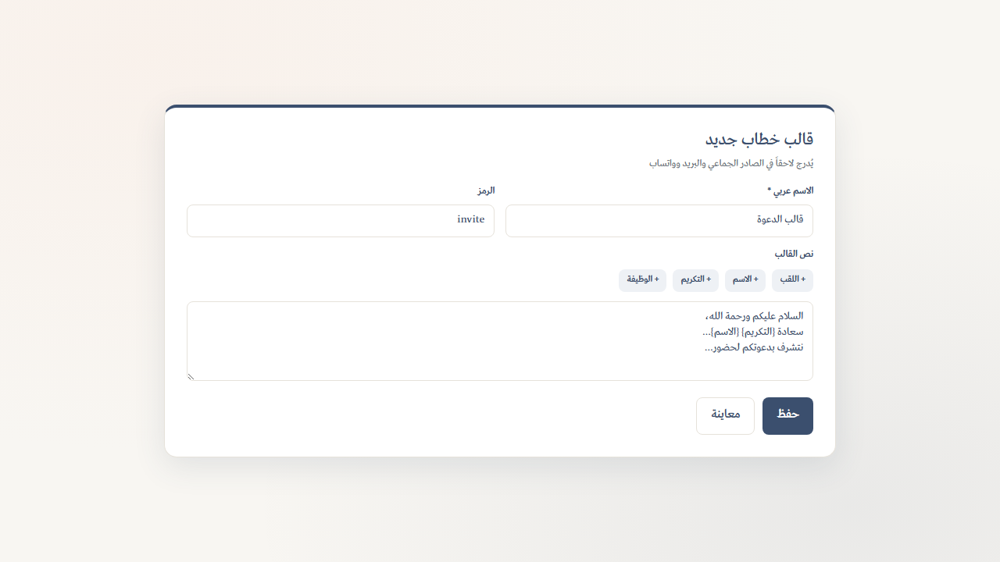

قالب جديد ← نص + حقول المستلم ← معاينة ← حفظ ← **إدراج قالب** لاحقاً في الجماعي/الخطاب.

---

## 27) التحقق بـ QR

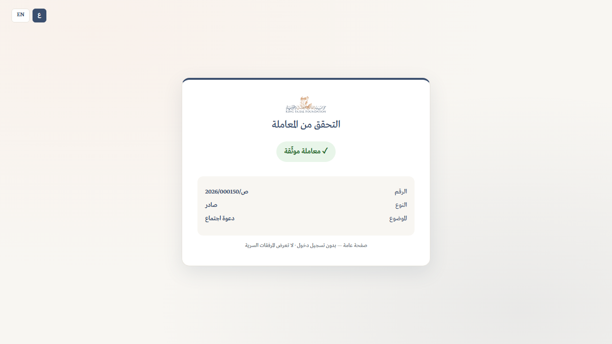

صفحة عامة بمسح QR أو إدخال الرمز: أصالة المعاملة والرقم والنوع؛ وقد يظهر النص أو RSVP. بدون المرفقات السرية. تبديل ع/EN متاح.

---

## 28) الملف الشخصي

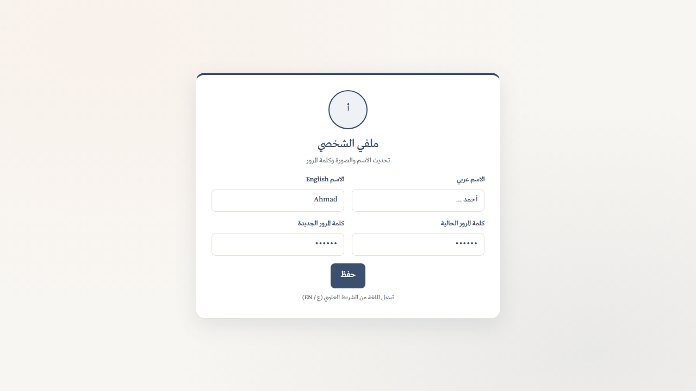

الاسم والصورة وتغيير كلمة المرور. البريد معرف الدخول. اللغة من الشريط العلوي.

---

## 29) نصائح

- الدخول بالبريد فقط؛ لا تشارك كلمة المرور.
- راجع «يحتاج إجراء» والجرس يومياً (وارد / صادر / داخلي).
- من جهاز مشترك: **خروج**.
- للتصدير الشامل: التقارير ← Excel.
- لا تُلغِ صادراً إلا بعد التأكد — الإلغاء لا يُراجع والرقم يبقى محجوزاً.
- في ملصق الظرف: ابدأ من الخانة الصحيحة واطبع بورق Letter حسب القالب.
- في الملصق الحراري: اختر مقاس الطابعة المطابق للقالب (50×25 أو 44×22 ملم).
- للمساعدة أو إعادة الدعوة: مدير النظام.
