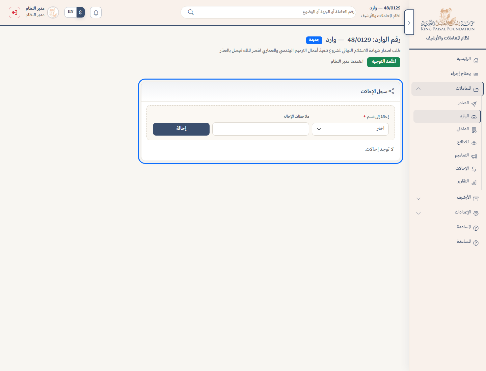
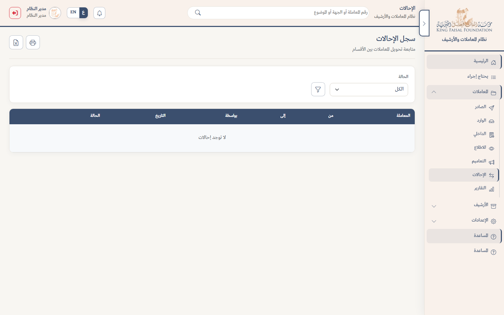

# الإحالة

الإحالة = تحويل المعاملة من قسم إلى قسم آخر داخل الجهة (ليست إرسالاً خارجياً للجهة).

## أين تُنشأ؟

من صفحة **عرض الوارد** أو **عرض الداخلي** — بطاقة **سجل الإحالات**.

(الصادر لا يُحال بهذه البطاقة؛ مساره الإصدار والتسليم.)

## خطوات الإحالة

1. افتح الوارد أو الداخلي.
2. انزل إلى بطاقة **سجل الإحالات**.
3. اختر **إحالة إلى قسم**.
4. اكتب **ملاحظات الإحالة** إن لزم.
5. اضغط **إحالة**.

بعدها تصبح حالة المعاملة محالة، وينتقل اختصاص المتابعة للقسم المستلم، ويُشعَر المعنيون.

## استلام الإحالة

القسم المستلم يرى الإحالة بحالة بانتظار، ثم من البطاقة أو من قائمة **الإحالات** يضغط **استلام**.

## قائمة الإحالات

من القائمة الجانبية: **الإحالات** — جدول بكل الإحالات مع فلتر الحالة وطباعة/تصدير.

## الداخلي

عند **حفظ وإحالة** معاملة داخلية تُنشأ إحالة تلقائية للقسم المستلم. يمكن لاحقاً إحالة إضافية بنفس البطاقة.

لا تُحال معاملة مغلقة أو معلّقة في الاعتماد حتى يُرفع القيد.
